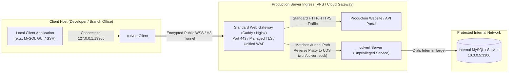
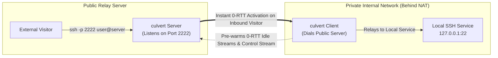
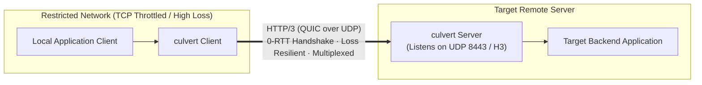

# culvert

> **High-performance, transparent TCP & UDP tunneling tool designed for standardized and compliant servers.**  
> Built with Rust, supporting WebSocket, HTTP/3 (QUIC), and Unix Domain Sockets for ultra-low latency and clean architecture.

English | [简体中文](README_zh.md)

[](https://opensource.org/licenses/MPL-2.0)
[](https://www.rust-lang.org)
[](.)

---

## Table of Contents

- [Design Philosophy](#design-philosophy)
- [Key Highlights](#key-highlights)
- [Network Topology & Typical Scenarios](#network-topology--typical-scenarios)
- [Protocol & Mode Matrix](#protocol--mode-matrix)
- [Quick Start](#quick-start)
- [Command-Line Reference](#command-line-reference)
- [Configuration Reference](#configuration-reference)
- [Production Deployment Guide (Caddy / Nginx / Systemd)](#production-deployment-guide)
- [Configuration Examples](#configuration-examples)
- [FAQ & Troubleshooting](#faq--troubleshooting)
- [Compliance Warning & Legal Disclaimer](#compliance-warning--legal-disclaimer)
- [License](#license)

---

## Design Philosophy

In enterprise production environments and compliant server architectures, standardized network design, clear security perimeters, and sustainable operations are paramount. `culvert` was created after examining the architectural pitfalls of traditional tunneling tools.

### 1. Built for Standardized, Compliant Server Deployments

- **Moving away from fragile "reverse takeover" camouflages**: Many traditional tunneling and proxy tools adopt monolithic designs that insist on listening directly on public ports (`80` / `443`). They place themselves *in front of* standard web services, implementing complex internal camouflages or fallbacks to redirect regular web traffic. In corporate and compliant environments, this introduces significant risks:
  - Requires elevated root/admin privileges to bind low-numbered ports.
  - Results in black-box TLS certificate handling that bypasses corporate PKI.
  - Bypasses existing unified Web Application Firewalls (WAF), CDNs, and audit log pipelines.
  - Risks detection and disruption due to subtle TLS/HTTP protocol fingerprinting anomalies.
- **Elegantly positioned behind standard web services**: `culvert` adopts a standardized **backend-oriented architecture**. It is designed to run behind mature, compliant web gateways such as Caddy or Nginx, connecting via Unix Domain Sockets (UDS) or local loopback:
  - **Compliant ingress management**: Standard web servers manage public ports `80`/`443`, automated ACME certificate issuance and renewal, centralized WAF filtering, and compliance logging.
  - **Least privilege and isolation**: `culvert` runs as an unprivileged system user (e.g., `culvert`), binds no external public ports, and minimizes the host attack surface.
  - **Natural and precise routing**: Ordinary web requests serve production websites or API portals. Only requests matching the authenticated tunnel path (e.g., `/tunnel`) with valid credentials are proxy-passed to `culvert`.

### 2. Dedicated to Core TCP & UDP Tunneling & the Unix Philosophy

- **Minimalist scope**: `culvert` focuses strictly on transparent, reliable, high-throughput TCP and UDP port forwarding (opaque byte streams and `[u16 len | payload]` length-framed datagrams). It intentionally avoids bloated SOCKS5/HTTP proxy semantics, custom encryption layers, or redundant certificate management.
- **Composable and decoupled**: When application-level authentication, traffic auditing, or access control is required, `culvert` can be chained with established, specialized tools. Each component does one thing well, ensuring high cohesion, loose coupling, and long-term maintainability.
- **Three independent layers**: frontend (TCP/UDS & per-peer NAT-demuxed UDP port mapping), core (session lifecycle), and backend (uniform relay I/O over WS/WSS/H3/QUIC/UDS) share a neutral `io` vocabulary. `core::serve` selects an I/O pump (`StreamStreamPump`, `DatagramStreamPump`, `StreamDatagramPump`, `DatagramDatagramPump`) by channel kind and never moves bytes itself. See [DESIGN.md §5.7](docs/DESIGN.md#57-three-layer-boundaries-and-the-pump-registry).

---

## Key Highlights

### 🌟 Highlight 1: HTTP/3 (H3 / QUIC) Reverse Proxy & TCP/UDP Tunneling (Breakthrough for TCP-Restricted Networks)

In production networking, engineers frequently encounter restrictive environments: enterprise firewalls or intermediate carriers may throttle, aggressively terminate, or limit concurrent long-lived TCP connections. On high-latency or packet-loss-heavy links (e.g., cross-region connections), standard TCP congestion control and head-of-line blocking cause severe throughput degradation.

`culvert` provides native support for **HTTP/3 `CONNECT` tunneling over QUIC**:

- **Loss resilience & zero head-of-line blocking**: Leveraging UDP-based multiplexing, packet drops on one stream never stall or impair sibling streams.
- **Connection Migration**: QUIC preserves active connections when clients switch between Wi-Fi and cellular networks.
- **Rapid Handshakes**: Takes full advantage of 0-RTT and 1-RTT connection establishment, delivering high stability and responsiveness where TCP is restricted or unreliable.

### ⚡ Highlight 2: Unique 0-RTT Connection Pool (Bidirectional Pre-Warmed Streams)

Traditional tunneling tools initiate an end-to-end handshake (TCP + TLS + HTTP Upgrade/CONNECT) only after an inbound visitor arrives, adding 1 to 3 RTTs of latency before data can flow. This noticeable lag impairs interactive sessions like SSH, DNS lookups, or bursty short connections like MySQL queries.

`culvert` implements a **bidirectional pre-warmed stream pool** for both TCP and UDP:

- **Forward Mode**: The client automatically maintains a pool of pre-warmed idle streams in the background. When a local TCP connection or UDP client flow arrives, an idle stream is acquired instantly (0-RTT), activated via a lightweight in-band packet (`0xA5` for TCP or `0xA7` for UDP + target address), and data transfer begins immediately while the pool is replenished asynchronously.
- **Reverse Mode**: The client pre-establishes idle reverse streams queued per `(protocol, listen)` on the server. When an external TCP visitor or UDP peer arrives at the server port, the server pops an idle stream and activates it with a single byte (`0xA5` TCP / `0xA7` UDP) without round-trip signaling.
- **Storm protection & emergency failover**: Handshake concurrency is governed by a semaphore to prevent connection storms on reconnect, backed by exponential backoff, server-authoritative stream lifecycles, and emergency control promotion (`0xA6`).

---

## Network Topology & Typical Scenarios

### Scenario 1: Backend Deployment Behind a Standard Web Server (Recommended)

Public ingress is managed by a standard web server (Caddy / Nginx), while `culvert` operates as an unprivileged backend service via Unix Domain Sockets.



---

### Scenario 2: Reverse Tunnel (Securely Expose Private NAT Services)

Expose private services located behind NAT (home lab, branch office, or private cloud) through a public relay server.



---

### Scenario 3: HTTP/3 (QUIC) Direct Tunnel for Restricted Networks

Bypass TCP connection degradation on lossy, high-latency, or TCP-throttled links using HTTP/3 (QUIC over UDP).



---

## Protocol & Mode Matrix

`server.listen` and `tunnels[].endpoint` accept the same set of URL schemes:

| Scheme | Transport Protocol | Default Port | Typical Use Case |
| :--- | :--- | :--- | :--- |
| `ws` | WebSocket over TCP | 80 | Loopback or reverse-proxied behind local Nginx / Caddy |
| `wss` | WebSocket over TCP + TLS | 443 | Standard encrypted transport across public networks |
| `h3` / `https` | HTTP/3 (`CONNECT` over QUIC/UDP) | 443 | **TCP-restricted, lossy, or high-latency networks** |
| `quic` | Raw QUIC bidirectional streams | 443 | High-performance pure UDP transport |
| `ws+unix` | WebSocket over Unix Domain Socket | — | **Recommended! Clean backend integration with Caddy / Nginx** |
| `wss+unix` | WebSocket over UDS with TLS | — | Local domain sockets requiring TLS encryption |

> [!NOTE]
> Unix domain socket URLs support query parameters for path routing and socket permissions:  
> `ws+unix:///run/culvert.sock?path=/tunnel&chmod=0o660`  
> (`chmod` accepts octal values like `660`, `0660`, or `0o660`).

### Port Mapping Modes & Protocols

| Mode (`mode`) | Supported Protocols (`protocol`) | Listener Bound On | Target Dialed By | Stream Pool (`pool_size`) | Primary Application |
| :--- | :--- | :--- | :--- | :--- | :--- |
| `forward` (default) | `tcp` (default), `udp` | Client host | Ingress server | Shared pre-warmed pool (`0xA5` / `0xA7`) | Access remote private resources (DBs, internal DNS, APIs) |
| `reverse` | `tcp` (default), `udp` | Ingress server | Client host | Per-mapping 0-RTT inbound pool (`0xA5` / `0xA7`) | Expose private NAT services to the public (SSH, WireGuard, game servers) |

> [!TIP]
> **Same-Port TCP + UDP Coexistence**: A single tunnel (or different tunnels) may bind both `protocol: "tcp"` and `protocol: "udp"` on the exact same `listen` IP and port, while duplicate binds on the same protocol are caught during `--check`. UDP mappings reject `unix://` addresses in `listen`/`target`, while still tunneling cleanly over `ws+unix://` and `wss+unix://` server endpoints.

---

## Quick Start

### 1. Build and Install

Prerequisites: Rust 1.85+ (Edition 2024) and a C/C++ build toolchain.

```bash
# Clone repository
git clone https://github.com/spritetong/culvert.git
cd culvert

# Build release binary
cargo build --release

# Output binary: target/release/culvert
```

### 2. Static Configuration Validation

Before running in production, validate your configuration file syntax and constraints with `--check`:

```bash
target/release/culvert --check -c config.yaml
```

### 3. Basic Forward Tunnel Example

**`server.yaml`** — Runs on the public relay server:

```yaml
log:
  level: "info"

server:
  listen: "ws://0.0.0.0:8080/tunnel"
  token: "PLEASE_REPLACE_WITH_A_SECRET_TOKEN"
  default_target: "127.0.0.1:5201"
```

**`client.yaml`** — Runs on your local client machine:

```yaml
log:
  level: "info"

tunnels:
  - tag: "my-first-tunnel"
    endpoint: "ws://server.example.com:8080/tunnel"
    token: "PLEASE_REPLACE_WITH_A_SECRET_TOKEN"
    mappings:
      - mode: "forward"
        listen: "127.0.0.1:18080"
        target: "127.0.0.1:8080"
```

Start both processes:

```bash
# On the server host
culvert -c server.yaml

# On the client host
culvert -c client.yaml

# Test connectivity: accessing local port routes to the remote target
curl http://127.0.0.1:18080/
```

---

## Command-Line Reference

```text
culvert [OPTIONS]
```

| Option | Argument | Description | Default |
| :--- | :--- | :--- | :--- |
| `-c`, `--config` | `<PATH>` | Path to YAML configuration file | `config.yaml` |
| `-w`, `--worker-threads` | `<NUM>` | Tokio runtime worker threads (`1` selects current-thread runtime) | Auto-detected CPU cores |
| `--check` | None | Parse and validate configuration without binding sockets or starting runtime | Off |
| `-h`, `--help` | None | Print command-line help | — |
| `-V`, `--version` | None | Print version number | — |

> [!TIP]
> **Graceful Shutdown**: Upon receiving the first termination signal (`SIGINT` / `SIGTERM`), `culvert` initiates graceful task shutdown with a 10-second deadline. A second signal forces an immediate exit with code `130`.

---

## Configuration Reference

Configuration files use standard YAML. `culvert` enforces strict schema validation (`deny_unknown_fields`) to catch spelling mistakes and misconfigurations at load time.

### 1. Top-Level Options

| Key | Type | Required | Default | Notes |
| :--- | :--- | :--- | :--- | :--- |
| `log` | object | No | `level: info` | Logging parameters. |
| `worker_threads` | integer | No | Auto | Tokio worker thread count (must be `>= 1`). |
| `dns` | object | No | System | Global DNS resolution policy and upstreams. |
| `dialer` | object | No | See below | Global dialing timeouts and keepalive controls. |
| `tls` | object | No | — | Global TLS certificate, key, and verification options. |
| `server` | object | No | — | Ingress listener definition. |
| `tunnels` | list | No | `[]` | List of tunnel clients. |

---

### 2. `log`

```yaml
log:
  level: "info"       # trace | debug | info | warn | error (RUST_LOG takes precedence)
  output: "stdout"    # stdout | stderr
  no_color: false     # Disable ANSI terminal colors
```

---

### 3. `dns`

```yaml
dns:
  strategy: "prefer_ipv4"   # prefer_ipv4 | prefer_ipv6 | ipv4_only | ipv6_only
  cache_capacity: 1024      # Maximum cached DNS entries (default TTL: 300s)
  resolvers:
    - "system://0.0.0.0"                                  # System resolver
    - "udp://1.1.1.1:53"                                  # Standard UDP DNS
    - "tcp://1.1.1.1:53"                                  # Standard TCP DNS
    - "tls://8.8.8.8?sni=dns.google"                      # DNS-over-TLS (DoT)
    - "https://1.1.1.1/dns-query?sni=cloudflare-dns.com" # DNS-over-HTTPS (DoH)
```

---

### 4. `dialer`

```yaml
dialer:
  connect_timeout: "10s"      # TCP connection timeout
  tcp_nodelay: true           # Enable TCP_NODELAY to avoid packet coalescing lag
  bind_interface: "eth0"      # Bind outbound interface via SO_BINDTODEVICE (optional)
  heartbeat_interval: "15s"   # Heartbeat probe interval during inactivity
  idle_timeout: "30s"         # Idle timeout before connection teardown (> heartbeat_interval)
  udp_idle_timeout: "30s"     # UDP NAT flow expiration timeout on inactivity (must be > 0; default: 30s)
```

---

### 5. `tls`

```yaml
tls:
  server_name: "tunnel.example.com"  # Override SNI hostname
  insecure: false                    # Skip server certificate verification (testing only)
  ca_certificate: "/path/to/ca.pem"  # Custom CA PEM for server verification
  client_certificate: "/path/to/client.pem" # mTLS client certificate
  client_key: "/path/to/client.key"         # mTLS client private key
  min_version: "1.3"                 # Minimum TLS version ("1.2" or "1.3")
  max_version: "1.3"                 # Maximum TLS version ("1.2" or "1.3")
```

---

### 6. `server`

```yaml
server:
  listen:
    - "ws+unix:///run/culvert.sock?path=/tunnel&chmod=0o660"
    - "wss://0.0.0.0:8443/tunnel"
    - "h3://0.0.0.0:8443/tunnel"
  token: "SECURE_AUTH_TOKEN"         # Pre-shared token (max 256 bytes)
  default_target: "127.0.0.1:5201"    # Fallback target if none supplied
  heartbeat_interval: "15s"          # Server keepalive interval
  idle_timeout: "30s"                # Server idle timeout (> heartbeat_interval)
  udp_idle_timeout: "30s"            # Server-side idle timeout for UDP NAT flows (default: 30s)
  # certificate: "/path/to/cert.pem" # TLS cert (auto-generates self-signed if omitted)
  # key: "/path/to/key.pem"          # TLS private key
```

---

### 7. `tunnels[]`

```yaml
tunnels:
  - tag: "corp-internal"              # Unique identifier for this tunnel
    endpoint: "wss://tunnel.example.com/tunnel" # Ingress URL or endpoint object
    token: "SECURE_AUTH_TOKEN"        # Must match server.token
    pool_size: 8                      # Pre-warmed 0-RTT stream pool size
    http_headers:                     # Optional: custom HTTP headers sent during handshake
      Host: "tunnel.example.com"      # Override Host header (e.g. for reverse proxy vhost routing)
      User-Agent: "culvert/1.0"
    retry:
      delay: "3s"                     # Delay between reconnect attempts
      max_retries: 10                 # Maximum retry attempts (omit for infinite)
    mappings:
      - mode: "forward"               # Forward TCP mode (protocol defaults to "tcp")
        protocol: "tcp"               # Optional: "tcp" (default) or "udp"
        listen: "127.0.0.1:13306"
        target: "10.0.0.5:3306"
      - mode: "forward"               # Forward UDP mode
        protocol: "udp"
        listen: "127.0.0.1:15353"
        target: "1.1.1.1:53"
        udp_idle_timeout: "15s"       # Optional: per-mapping override for UDP NAT idle expiry
      - mode: "reverse"               # Reverse mode
        listen: "0.0.0.0:2222"        # Bound on the remote server
        target: "127.0.0.1:22"        # Dialed by the local client
```

Each entry in `mappings` accepts:

| Key | Type | Required | Default | Notes |
| :--- | :--- | :--- | :--- | :--- |
| `mode` | string | No | `"forward"` | `"forward"` or `"reverse"`. |
| `protocol` | string | No | `"tcp"` | `"tcp"` or `"udp"`. Same-port TCP+UDP forward mappings are allowed. |
| `listen` | string | Yes | — | `ip:port`, `hostname:port`, `[ipv6]:port`, or `unix://path` (TCP only). |
| `target` | string | Yes | — | `ip:port`, `hostname:port`, `[ipv6]:port`, or `unix://path` (TCP only). |
| `udp_idle_timeout` | duration | No | `dialer.udp_idle_timeout` (`30s`) | Overrides `dialer.udp_idle_timeout` on the tunnel client side; server-side UDP flows use `server.udp_idle_timeout`. Must be `> 0`. |

---

## Production Deployment Guide

### 1. Caddyfile Configuration (Recommended)

Caddy provides automated HTTPS certificate issuance, HTTP/3 support, and clean Unix Domain Socket reverse proxying:

**`server.yaml`**:

```yaml
log:
  level: "info"
server:
  listen: "ws+unix:///run/culvert.sock?path=/tunnel&chmod=0o660"
  token: "CHANGE_TO_A_VERY_SECURE_TOKEN"
```

**`Caddyfile`**:

```caddy
tunnel.example.com {
    # Match dedicated tunnel endpoint path
    @tunnel path /tunnel
    handle @tunnel {
        reverse_proxy unix//run/culvert.sock {
            # Keep stream_timeout at 0 (unlimited) to maintain long-lived streams
        }
    }

    # All other paths display a standard, compliant corporate site
    handle {
        respond "Welcome to Corporate Gateway. System status: Operational." 200
    }
}
```

---

### 2. Nginx Configuration

For environments using Nginx as the primary reverse proxy:

```nginx
# /etc/nginx/sites-available/tunnel.conf

server {
    listen 80;
    server_name tunnel.example.com;
    return 301 https://$host$request_uri;
}

server {
    listen 443 ssl http2;
    server_name tunnel.example.com;

    ssl_certificate /etc/letsencrypt/live/tunnel.example.com/fullchain.pem;
    ssl_certificate_key /etc/letsencrypt/live/tunnel.example.com/privkey.pem;

    # Standard public website content
    location / {
        root /var/www/html;
        index index.html;
    }

    # Dedicated culvert ingress
    location = /tunnel {
        proxy_pass http://unix:/run/culvert.sock;
        
        # Preserve WebSocket upgrade headers
        proxy_http_version 1.1;
        proxy_set_header Upgrade $http_upgrade;
        proxy_set_header Connection "upgrade";
        proxy_set_header Host $host;

        # Keep long-lived tunnel connections active
        proxy_read_timeout 3600s;
        proxy_send_timeout 3600s;
        proxy_buffering off;
    }
}
```

---

### 3. Linux Systemd Service Setup

To manage `culvert` reliably as a background system daemon:

Create a dedicated unprivileged user and directories:

```bash
sudo useradd --system --shell /usr/sbin/nologin --user-group culvert
sudo mkdir -p /etc/culvert /run
sudo chown culvert:culvert /run
```

Create `/etc/systemd/system/culvert.service`:

```ini
[Unit]
Description=culvert High-Performance TCP & UDP Tunnel Service
After=network.target network-online.target
Wants=network-online.target

[Service]
Type=simple
User=culvert
Group=culvert
ExecStart=/usr/local/bin/culvert -c /etc/culvert/server.yaml
Restart=on-failure
RestartSec=5s
LimitNOFILE=65535

# Security hardening
ProtectSystem=full
ProtectHome=true
NoNewPrivileges=true
PrivateTmp=true

[Install]
WantedBy=multi-user.target
```

Reload and enable the service:

```bash
sudo systemctl daemon-reload
sudo systemctl enable --now culvert
sudo systemctl status culvert
```

---

## Configuration Examples

### 1. Reverse Mapping for SSH (with 0-RTT Stream Pool)

Expose a local SSH service located behind NAT to port `2222` on a remote server:

```yaml
tunnels:
  - tag: "office-ssh"
    endpoint: "wss://tunnel.example.com/tunnel"
    token: "CHANGE_ME"
    pool_size: 4                     # Pre-warms 4 idle reverse streams for 0-RTT activation
    mappings:
      - mode: "reverse"
        listen: "0.0.0.0:2222"       # Bound on the remote server
        target: "127.0.0.1:22"       # Local SSH port
```

Connect via SSH:

```bash
ssh -p 2222 user@tunnel.example.com
```

---

### 2. Standalone HTTP/3 Direct Tunnel for Lossy Networks

In deployments without a web proxy where direct QUIC over UDP is preferred:

**`server.yaml`**:

```yaml
server:
  listen:
    - "h3://0.0.0.0:8443/tunnel"
  token: "CHANGE_ME"
  # Generates an ephemeral self-signed certificate if certificate/key are omitted
```

**`client.yaml`**:

```yaml
tls:
  insecure: true                     # Required only when using self-signed certs
tunnels:
  - tag: "h3-fast-link"
    endpoint: "h3://server.example.com:8443/tunnel"
    token: "CHANGE_ME"
    pool_size: 4
    mappings:
      - mode: "forward"
        listen: "127.0.0.1:13306"
        target: "127.0.0.1:3306"
```

---

### 3. Multi-Mapping Cluster with Shared Connection Pool

A single tunnel endpoint can aggregate multiple forward and reverse mappings across TCP, UDP, and Unix domain sockets:

```yaml
tunnels:
  - tag: "dev-cluster"
    endpoint: "wss://tunnel.example.com/tunnel"
    token: "CHANGE_ME"
    pool_size: 8
    mappings:
      # Forward mapping to remote MySQL database (TCP)
      - mode: "forward"
        listen: "127.0.0.1:13306"
        target: "10.0.0.5:3306"
      # Forward mapping to remote Docker daemon socket (TCP -> UDS)
      - mode: "forward"
        listen: "127.0.0.1:18000"
        target: "unix:///var/run/docker.sock"
      # Forward UDP DNS traffic on the loopback resolver port
      - mode: "forward"
        protocol: "udp"
        listen: "127.0.0.1:15353"
        target: "1.1.1.1:53"
        udp_idle_timeout: "15s"
      # Reverse mapping exposing local dev server (TCP)
      - mode: "reverse"
        listen: "0.0.0.0:8000"
        target: "127.0.0.1:3000"
```

---

### 4. Forward & Reverse UDP Tunneling (DNS / WireGuard)

Forward local UDP DNS queries to a private resolver and expose a private NATed WireGuard UDP service on the remote relay, including sharing a port between TCP and UDP:

```yaml
tunnels:
  - tag: "udp-services"
    endpoint: "quic://server.example.com:8443/tunnel"
    token: "CHANGE_ME"
    pool_size: 4                     # Supports 0-RTT UDP activation (0xA7)
    mappings:
      - mode: "forward"
        protocol: "udp"
        listen: "127.0.0.1:1053"
        target: "10.0.0.2:53"
        udp_idle_timeout: "15s"      # Reclaim short-lived DNS NAT flows after 15s
      - mode: "reverse"
        protocol: "udp"
        listen: "0.0.0.0:51820"      # Public WireGuard UDP port on server
        target: "127.0.0.1:51820"    # Local WireGuard daemon behind NAT
        udp_idle_timeout: "120s"     # Keep long-lived VPN peer sessions warm longer
```

---

## FAQ & Troubleshooting

### Q1: `Permission denied` error when connecting to Unix Domain Sockets?

**Answer**: Check socket permissions and ownership. Append `?chmod=0o660` to the socket URL and verify that the reverse proxy (Caddy / Nginx) and `culvert` share a common user group:

```yaml
server:
  listen: "ws+unix:///run/culvert.sock?path=/tunnel&chmod=0o660"
```

### Q2: Idle tunnel connections terminate after a few minutes?

**Answer**: This is typically caused by reverse proxy idle timeouts.

- In **Caddy**: Ensure `stream_timeout` is kept at `0` (unlimited).
- In **Nginx**: Ensure `proxy_read_timeout 3600s;` and `proxy_send_timeout 3600s;` are set.
- Ensure `dialer.heartbeat_interval` (default `15s`) is active to periodically refresh connection liveness.

### Q3: When should I choose HTTP/3 (H3) over WebSocket (WSS)?

**Answer**:

- **Choose WSS**: In standard cloud environments with existing Caddy or Nginx ingress infrastructure, where sharing port `443` with standard web traffic is desired.
- **Choose H3 / QUIC**: In environments where TCP is subject to strict QoS, connection resets, or where links exhibit high packet loss and latency. QUIC's loss resilience and lack of head-of-line blocking offer substantial stability gains.

---

## Compliance Warning & Legal Disclaimer

> [!CAUTION]
>
> ### ⚠️ Strict Compliance Warning
>
> `culvert` is developed exclusively for **authorized and lawful** system operations, private network diagnostics, remote administration, and academic networking research.
>
> **It is strictly prohibited** to use `culvert` for any unauthorized access, computer intrusion, malicious cyber operations, telecommunication fraud, or any activity that evades legal and regulatory compliance.

### Legal Disclaimer

1. **User Responsibility**: Users are solely responsible for understanding and adhering to all applicable laws, regulations, and network usage policies in their jurisdiction before building, deploying, or operating this software.
2. **Provided "AS-IS"**: This software is provided "as is", without warranty of any kind, express or implied. The user assumes all legal, civil, regulatory, and financial liabilities arising from its use or misuse.
3. **No Contributor Liability**: Under no circumstances shall the author, copyright holders, or contributors be liable for any direct, indirect, incidental, or consequential damages resulting from the use or abuse of this software.

---

## License

This project is licensed under the [Mozilla Public License Version 2.0 (MPL-2.0)](LICENSE).  
For detailed technical architecture and protocol specifications, refer to [DESIGN.md](docs/DESIGN.md) and [PRD.md](docs/PRD.md).
