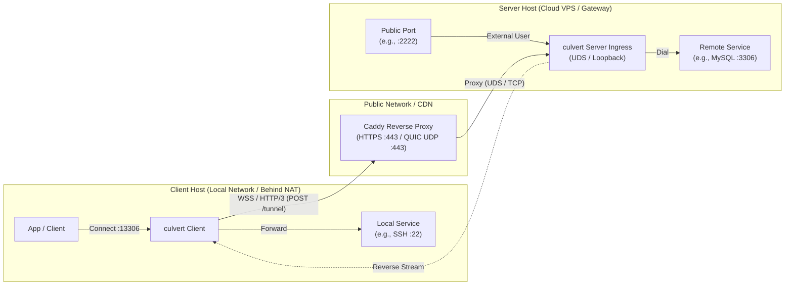

# culvert

[](https://opensource.org/licenses/MPL-2.0)
[](https://www.rust-lang.org/)

**culvert** is a high-performance, lightweight, production-ready bidirectional TCP tunneling system engineered to pair seamlessly with modern edge reverse proxies (such as **Caddy** or **Nginx**).

Designed as a modern, clean replacement for tools like `wstunnel`, `culvert` eliminates protocol bloat, complex frame encapsulation state machines, and unnecessary internal certificate managers. It delivers near-bare-metal throughput and microsecond latency over HTTP/3 (QUIC) and WebSocket (WSS) while disguising traffic behind standard HTTPS ports.

---

## Key Highlights & Design Philosophy

- **Zero ACME Bloat**: `culvert` delegates public ACME certificates to reverse proxies like Caddy. The server ingress listens on Unix Domain Sockets (UDS) or internal loopback with zero public TLS certificate renewal complexity. (Direct standalone TLS termination with auto-generated or custom certificates is also supported).
- **Native QUIC & High-Speed WebSocket**:
  - **HTTP/3**: Multiplexes tunnels directly over native QUIC streams. Packet loss on one connection never blocks other streams (zero TCP Head-of-Line blocking).
  - **WSS**: Built on `fastwebsockets` with AVX2/NEON SIMD-accelerated masking.
- **Decoupled 0-RTT Pre-warmed Connection Pool**: Pre-establishes idle tunnel streams in the background. Client connections acquire a ready stream immediately without waiting for transport or TLS handshakes.
- **Multi-Mapping Cluster Sharing a Single Pool**: Multiple forward and reverse port mappings can share a single tunnel endpoint and connection pool. Remote targets are dialed on-demand only when client traffic arrives, preventing premature socket exhaustion.
- **Unified Server & Client Coexistence**: Run server ingress listeners and multiple tunnel clients simultaneously in a single process from a single declarative YAML file.
- **Optional Constant-Time Authentication**: High-entropy Pre-Shared Key (PSK) token validation using constant-time comparison immune to timing side-channel attacks. Token can be omitted for trusted or reverse-proxy-authenticated environments.
- **Advanced DNS & Socket Tuning**: Supports libc system DNS, standard UDP DNS, DNS-over-HTTPS (DoH), and DNS-over-TLS (DoT), with configurable IP family selection (`prefer_ipv4`, `prefer_ipv6`, `ipv4_only`, `ipv6_only`).

---

## Architecture Overview



---

## Installation & Build

### Prerequisites

- [Rust 1.85+](https://www.rust-lang.org/tools/install) (Edition 2024 support)
- C/C++ build toolchain (for `ring` / `mimalloc`)

### Build from Source

```bash
# Clone the repository
git clone https://github.com/spritetong/culvert.git
cd culvert

# Build optimized release binary
cargo build --release

# The compiled binary is located at:
./target/release/culvert
```

---

## Command-Line Usage

```bash
culvert [OPTIONS]
```

### Options

| Flag | Short | Environment / Argument | Description | Default |
| :--- | :---: | :--- | :--- | :--- |
| `--config` | `-c` | `<PATH>` | Path to the YAML configuration file | `config.yaml` |
| `--worker-threads` | `-w` | `<NUM>` | Override number of Tokio runtime worker threads (`1` for single-threaded runtime) | Auto-detect CPU cores |
| `--check` | | | Validate configuration syntax, schema, and semantics without starting the daemon | |
| `--help` | `-h` | | Print command-line help message | |
| `--version` | `-V` | | Print version information | |

#### Example CLI Commands

```bash
# Validate configuration file without starting services
./culvert --check -c /etc/culvert/config.yaml

# Run with default config.yaml
./culvert

# Run with a custom config path and 2 worker threads
./culvert -c /etc/culvert/server.yaml -w 2
```

---

## Workspace & Library Usage

`culvert` is structured as a Cargo workspace with two distinct crates:
- **`culvert`**: The core library exposing client/server runners, connection pooling, multiplexing, and protocol drivers for external programmatic integration.
- **`culvert-cli`**: Lightweight CLI frontend containing only `main.rs` and CLI argument parsing (compiled as the `culvert` binary).

### Using `culvert` as a Library

Add `culvert` to your `Cargo.toml`:

```toml
[dependencies]
culvert = { version = "0.1", path = "../path/to/crates/culvert" }
tokio = { version = "1", features = ["full"] }
tokio-util = "0.7"
```

#### Running an Ingress Server Service

```rust
use culvert::config::model::ServerConfig;
use culvert::server::ServerRunner;
use tokio_util::sync::CancellationToken;

#[tokio::main]
async fn main() -> Result<(), Box<dyn std::error::Error>> {
    let server_cfg = ServerConfig {
        listen: vec!["wss://127.0.0.1:8443/tunnel".to_string()],
        token: Some("MY_SECURE_TOKEN_32_BYTES_OR_MORE".to_string()),
        ..Default::default()
    };

    let cancel_token = CancellationToken::new();

    // Directly run the ingress server
    culvert::run_server(server_cfg, cancel_token).await?;
    Ok(())
}
```

#### Running a Client Tunnel Service

```rust
use culvert::client::ClientRunner;
use culvert::config::model::{PortMappingConfig, TunnelConfig, TunnelMode};
use tokio_util::sync::CancellationToken;

#[tokio::main]
async fn main() -> Result<(), Box<dyn std::error::Error>> {
    let tunnel_cfg = TunnelConfig {
        tag: "my-tunnel".to_string(),
        endpoint: "wss://127.0.0.1:8443/tunnel".into(),
        token: Some("MY_SECURE_TOKEN_32_BYTES_OR_MORE".to_string()),
        pool_size: Some(4),
        mappings: vec![PortMappingConfig {
            mode: Some(TunnelMode::Forward),
            listen: "127.0.0.1:13306".to_string(),
            target: "10.0.0.5:3306".to_string(),
            chmod: None,
        }],
        retry: None,
    };

    let cancel_token = CancellationToken::new();

    // Directly run client tunnels with supervised retry
    culvert::run_client(tunnel_cfg, cancel_token).await?;
    Ok(())
}
```

#### Running Combined Server & Client via Supervisor

```rust
use culvert::config::ConfigLoader;
use culvert::supervisor::TunnelSupervisor;
use tokio_util::sync::CancellationToken;

#[tokio::main]
async fn main() -> Result<(), Box<dyn std::error::Error>> {
    let app_config = ConfigLoader::from_file("config.yaml")?;
    let cancel_token = CancellationToken::new();

    culvert::run(app_config, cancel_token).await?;
    Ok(())
}
```

---

## Configuration Guide

Configuration files are written in declarative **YAML**. All top-level and nested sections are described below.

### 1. Global Settings

#### `log` (Logging Options)

Configures structured log output using Tokio `tracing`.

```yaml
log:
  level: "info"      # Log verbosity level: "trace", "debug", "info", "warn", "error" (default: "info")
                     # Note: RUST_LOG environment variable takes precedence over log.level if set.
  output: "stdout"    # Output destination: "stdout" or "stderr" (default: "stdout")
  no_color: false     # Set to true to disable ANSI terminal colors (default: false)
```

#### `worker_threads` (Runtime Concurrency)

```yaml
worker_threads: 4     # Number of Tokio worker threads.
                      # Omit or set to null for auto-detecting CPU cores.
                      # Set to 1 for lightweight single-threaded (current_thread) runtime.
```

---

### 2. DNS Settings (`dns`)

Global DNS resolution settings. Can be overridden per-endpoint.

`culvert` supports standard structured resolver configuration as well as standard URL schemes.

```yaml
dns:
  strategy: "prefer_ipv4"   # IP resolution preference:
                            #   "prefer_ipv4" (default): prefer IPv4, fallback to IPv6
                            #   "prefer_ipv6": prefer IPv6, fallback to IPv4
                            #   "ipv4_only": resolve A records only; ignore AAAA
                            #   "ipv6_only": resolve AAAA records only; ignore A
  resolvers:
    # Standard structured resolver objects:
    - type: "https"
      server: "1.1.1.1"
      tls:
        server_name: "cloudflare-dns.com"
    - type: "tls"
      server: "8.8.8.8"
      tls:
        server_name: "dns.google"
    - type: "udp"
      server: "1.1.1.1:53"
    - type: "system"

    # Standard URL strings are also supported:
    # - "https://1.1.1.1?sni=cloudflare-dns.com"
    # - "tls://8.8.8.8?sni=dns.google"
    # - "udp://1.1.1.1:53"
    # - "system://0.0.0.0"
  cache_capacity: 1024      # In-memory DNS cache capacity (default: 1024 entries)
```

#### Structured DNS Resolver Reference

| Field | Type | Description |
| :--- | :--- | :--- |
| `type` | String | Protocol type: `"https"` (DoH), `"tls"` (DoT), `"udp"`/`"dns"`, `"tcp"`, `"system"` |
| `server` | String | Upstream server IP address or hostname (e.g. `"1.1.1.1"`, `"8.8.8.8:853"`) |
| `port` | Integer | Custom upstream port (optional; defaults to standard port: 443 for https, 853 for tls, 53 for udp/tcp) |
| `path` | String | URL path for DoH (optional; e.g. `"/dns-query"`) |
| `tls.server_name` | String | Expected TLS SNI domain for DoH/DoT validation (e.g. `"cloudflare-dns.com"`) |

---

### 3. Socket Dialer Settings (`dialer`)

Low-level TCP socket configuration for outbound dialing. Can be overridden per-endpoint.

```yaml
dialer:
  connect_timeout: "10s"       # Socket connection timeout (e.g., "10s", "500ms", or raw seconds: 10; default: 10s)
  tcp_nodelay: true            # Disable Nagle's algorithm for low-latency transmission (default: true)
  heartbeat_interval: "15s"    # Heartbeat ping interval for transport / control streams (default: 15s)
  idle_timeout: "30s"          # Session idle timeout without incoming RX activity (default: 30s)
  bind_interface: "eth0"       # Bind outbound traffic to network interface (Linux only via SO_BINDTODEVICE)
```

---

### 4. TLS Settings (`tls`)

Global default TLS configuration for outbound client connections and fallback server termination.

> **Note**: TLS activation is strictly determined by the URL scheme (`wss://`, `https://`, `h3://`, `quic://`, `wss+unix://` vs unencrypted `ws://`, `ws+unix://`). The `tls` configuration block specifies cryptographic parameters (SNI, certificates, versions).

```yaml
tls:
  server_name: "tunnel.example.com"    # Override SNI hostname in TLS ClientHello
  insecure: false                      # Skip remote certificate verification (default: false)
  alpn: ["h3", "http/1.1"]             # Application-Layer Protocol Negotiation list
  ca_certificate: "/etc/ssl/ca.crt"    # Custom CA certificate file path for server verification
  client_certificate: "/etc/ssl/client.crt" # Client certificate for mutual TLS (mTLS)
  client_key: "/etc/ssl/client.key"         # Client private key for mutual TLS (mTLS)
  certificate: "/etc/ssl/server.crt"   # Server certificate for direct TLS termination
  key: "/etc/ssl/server.key"           # Server private key for direct TLS termination
  min_version: "1.2"                   # Minimum TLS version ("1.2" or "1.3")
  max_version: "1.3"                   # Maximum TLS version ("1.2" or "1.3")
```

---

### 5. Server Ingress (`server`)

Configures `culvert` as an ingress gateway on a cloud VPS or host.

> **Note**: In a typical setup behind Caddy or Nginx, configure `listen` to a Unix Domain Socket (`ws+unix:///run/tunnel.sock`) or loopback (`ws://127.0.0.1:8080/tunnel`).

`listen` takes a URL string or a list of URL strings. Both `server.listen` and client `tunnel.endpoint` share the exact same URL specification and supported schemes.

#### Server Listen Configuration

```yaml
server:
  # Ingress listeners: URL string or list of URL strings.
  # Supported schemes: ws, wss, https, h3, quic, ws+unix, wss+unix
  listen:
    # 1. Plaintext WebSocket over Unix Domain Socket (IPC behind Caddy/Nginx)
    - "ws+unix:///run/tunnel.sock?path=/tunnel&chmod=0o660"

    # 2. TLS-encrypted WebSocket over Unix Domain Socket
    - "wss+unix:///run/tunnel-tls.sock?path=/tunnel"

    # 3. Plaintext WebSocket over TCP
    - "ws://127.0.0.1:8080/tunnel"

    # 4. Standalone WSS (TLS terminated by culvert)
    - "wss://0.0.0.0:8443/tunnel"

    # 5. Standalone HTTP/3 over QUIC/UDP
    - "h3://0.0.0.0:8443/tunnel"

  # Pre-shared authentication token (PSK).
  # Optional: omit or set to null for unauthenticated mode (empty string "" is rejected).
  # Maximum length: 256 bytes.
  token: "SECRET_PRESHARED_TOKEN"

  # Fallback target address when the client does not specify one.
  # Supports 3 formats: ip:port, hostname:port, or unix://path
  default_target: "127.0.0.1:5201"

  # Optional transport keepalive and idle timeout settings
  # heartbeat_interval: "15s"  # Heartbeat probe interval (default: 15s)
  # idle_timeout: "30s"        # Inactivity timeout without incoming RX activity (default: 30s)

  # Optional direct TLS termination certificates (used for wss/h3/wss+unix if not behind a reverse proxy).
  # If omitted on TLS schemes, a temporary self-signed certificate is automatically generated.
  certificate: "/etc/ssl/server.crt"
  key: "/etc/ssl/server.key"

  # Optional advanced TLS settings overriding global tls block
  tls:
    min_version: "1.3"
```

#### Supported Schemes Reference (Server `listen` & Client `endpoint`)

Both `server.listen` and `tunnel.endpoint` support the exact same set of 7 URL schemes:

| Scheme | Transport / Protocol | Description & Example |
| :--- | :--- | :--- |
| `ws` | WebSocket over TCP (Plaintext) | `ws://127.0.0.1:8080/tunnel` |
| `wss` | WebSocket over TCP (TLS) | `wss://0.0.0.0:8443/tunnel` |
| `https` | HTTP/3 over QUIC/UDP (alias for `h3`) | `https://0.0.0.0:8443/tunnel` |
| `h3` | HTTP/3 over QUIC/UDP | `h3://0.0.0.0:8443/tunnel` |
| `quic` | Raw QUIC bidirectional stream | `quic://0.0.0.0:8443/tunnel` |
| `ws+unix` | WebSocket over Unix Domain Socket (Plaintext) | `ws+unix:///run/tunnel.sock?path=/tunnel&chmod=0o660` |
| `wss+unix` | WebSocket over Unix Domain Socket (TLS) | `wss+unix:///run/tunnel.sock?path=/tunnel` |

> [!NOTE]
> **Cross-Platform Unix Domain Socket (UDS) Support**:
> Unix Domain Sockets (`ws+unix`, `wss+unix`) are natively supported on **both Linux/macOS and Windows** (Windows 10 17063+ / Windows 11 / Windows Server 2019+ via WinSock `AF_UNIX`).
> - On Linux / macOS, file permissions mode can be configured via URL query parameter `?chmod=0o660`.
> - On Windows, filesystem socket paths such as `ws+unix://C:/temp/tunnel.sock` or `ws+unix://./local.sock` are fully supported with zero thread leaks and complete Tokio cancel-safety.
> - For `h3` and `https` listeners, `"h3"` is prioritized at index 0 of ALPN negotiation per RFC 7301 / RFC 9114 so standard HTTP/3 clients always negotiate `h3`. Custom `tls.alpn` options serve as fallback identifiers for raw QUIC or specialized non-browser clients.

> [!IMPORTANT]
> **Path Matching**: Client requests must match the server URL's path exactly (e.g., `/tunnel`). Mismatched paths receive an HTTP `404 Not Found` response to defend against scanner probes.

---

### 6. Tunnel Client (`tunnels`)

Defines one or more outbound tunnel client instances.

```yaml
tunnels:
  - tag: "corp-cluster"                         # Unique identifier for the tunnel
    endpoint: "wss://tunnel.example.com/tunnel" # Remote ingress server URL (or detailed endpoint object)
    token: "SECRET_PRESHARED_TOKEN"             # PSK token matching server.token (optional: omit or null, empty string rejected)
    pool_size: 8                                # Pre-warmed idle connection pool size (default: 0)

    # Reconnection & self-healing supervisor settings
    retry:
      delay: "3s"            # Wait time between reconnect attempts (e.g. "3s", "500ms")
      max_retries: 10        # Maximum retry attempts before giving up (omit or null for infinite)

    # Port mappings: Multiple forward and reverse mappings share this endpoint & connection pool
    mappings:
      # Local Forward Mapping: Clients connect to 127.0.0.1:15201, forwarded to 127.0.0.1:5201 on the server
      - mode: "forward"
        listen: "127.0.0.1:15201"
        target: "127.0.0.1:5201"

      # Local Forward Mapping: Forward local 13306 to internal database behind server
      - mode: "forward"
        listen: "127.0.0.1:13306"
        target: "10.0.0.5:3306"

      # Remote Reverse Mapping: Server opens port 2222; connections are routed back to local SSH (127.0.0.1:22)
      - mode: "reverse"
        listen: "0.0.0.0:2222"
        target: "127.0.0.1:22"

      # UDS Mapping: Forward or reverse over Unix Domain Socket (Linux, macOS, and Windows)
      # Mappings support 3 formats: ip:port, hostname:port, and unix://path (port cannot be omitted; unix:// avoids hostname collision)
      - mode: "forward"
        listen: "127.0.0.1:18080"
        target: "unix:///run/internal_service.sock"
      - mode: "reverse"
        listen: "unix:///run/public_api.sock"
        target: "127.0.0.1:8080"
```

#### Detailed Endpoint Configuration (Per-Endpoint Overrides)

Instead of a simple URL string, `endpoint` can be declared as an object with dedicated `dns`, `dialer`, and `tls` overrides:

```yaml
tunnels:
  - tag: "special-node"
    token: "SECRET_PRESHARED_TOKEN"
    endpoint:
      url: "wss://special.domain.com/tunnel"
      dns:
        strategy: "ipv4_only"
        resolvers:
          - "dns://1.1.1.1"
      dialer:
        connect_timeout: "10s"
        heartbeat_interval: "15s"
        idle_timeout: "30s"
      tls:
        server_name: "fronting-camouflage.com" # SNI domain fronting override
        insecure: false
        ca_certificate: "/path/to/custom-ca.pem"
    mappings:
      - mode: "forward"
        listen: "127.0.0.1:8080"
        target: "127.0.0.1:80"
```

---

## Configuration Recipes

### Recipe 1: Production Server Behind Caddy Reverse Proxy (Recommended)

Let Caddy handle public HTTPS, HTTP/3, and automated Let's Encrypt certificates. Culvert listens securely over Unix Domain Sockets.

#### `server.yaml` (culvert configuration)

```yaml
log:
  level: "info"

server:
  listen: "ws+unix:///run/culvert.sock"
  token: "MY_SECURE_TOKEN_32_BYTES_OR_MORE"
  default_target: "127.0.0.1:5201"
```

#### `Caddyfile` (Caddy reverse proxy configuration)

```caddy
tunnel.yourdomain.com {
    # Match culvert path
    @tunnel path /tunnel*

    # Reverse proxy WebSocket and HTTP traffic to culvert via Unix Domain Socket
    handle @tunnel {
        reverse_proxy unix//run/culvert.sock {
            # stream_timeout defaults to 0 (unlimited), keeping tunnel streams alive indefinitely
        }
    }

    # Optional camouflage / decoy website on root
    handle {
        respond "System Operational" 200
    }
}
```

---

### Recipe 2: Client Accessing Cloud Database (Local Forwarding)

Access an internal MySQL database (`10.0.0.5:3306`) in a private cloud network through a local port (`127.0.0.1:13306`).

#### `client.yaml`

```yaml
log:
  level: "info"

tunnels:
  - tag: "cloud-mysql"
    endpoint: "wss://tunnel.yourdomain.com/tunnel"
    token: "MY_SECURE_TOKEN_32_BYTES_OR_MORE"
    pool_size: 4
    mappings:
      - mode: "forward"
        listen: "127.0.0.1:13306"
        target: "10.0.0.5:3306"
```

Now connect locally using any database tool:

```bash
mysql -h 127.0.0.1 -P 13306 -u root -p
```

---

### Recipe 3: Exposing Local Home / NAT Machine to VPS (Remote Reverse Forwarding)

Expose a home computer's SSH server (`127.0.0.1:22`) on the public VPS port `2222` without configuring port forwarding on your home router.

#### `client.yaml` (running on home computer)

```yaml
log:
  level: "info"

tunnels:
  - tag: "home-ssh-reverse"
    endpoint: "wss://tunnel.yourdomain.com/tunnel"
    token: "MY_SECURE_TOKEN_32_BYTES_OR_MORE"
    pool_size: 4
    retry:
      delay: "3s"
    mappings:
      - mode: "reverse"
        listen: "0.0.0.0:2222"     # Bound on the VPS server
        target: "127.0.0.1:22"     # Local SSH server on home machine
```

Anyone connecting to `vps-ip:2222` is transparently routed back to your home machine's SSH server.

---

### Recipe 4: Standalone High-Speed HTTP/3 Direct Ingress

Run `culvert` directly without a reverse proxy, leveraging HTTP/3 over UDP port `8443`.

#### `server.yaml`

```yaml
log:
  level: "info"

server:
  listen:
    - "h3://0.0.0.0:8443/tunnel"
    - "wss://0.0.0.0:8443/tunnel"
  token: "MY_SECURE_TOKEN"
  # Omit cert/key to automatically generate self-signed TLS certificates,
  # or specify your own certificates:
  # certificate: "/etc/ssl/cert.pem"
  # key: "/etc/ssl/key.pem"
```

#### `client.yaml` (h3)

```yaml
log:
  level: "info"

# Trust self-signed certificates for direct connections
tls:
  insecure: true

tunnels:
  - tag: "direct-h3-tunnel"
    endpoint: "h3://vps.example.com:8443/tunnel"
    token: "MY_SECURE_TOKEN"
    pool_size: 8
    mappings:
      - mode: "forward"
        listen: "127.0.0.1:15201"
        target: "127.0.0.1:5201"
```

---

## Benchmarks & Performance

`culvert` comes equipped with automated Criterion micro-benchmarks and end-to-end `iperf3` benchmark suites.

### Running Benchmarks

```bash
# Run internal Criterion component benchmarks (zero-copy relay, codecs, sessions)
cargo bench

# Run end-to-end multi-stream iperf3 throughput tests (Linux / macOS)
./benchmarks/run-bench.sh 127.0.0.1 15201 8 10

# Run end-to-end throughput tests (Windows PowerShell)
.\benchmarks\run-bench.ps1 -TargetHost 127.0.0.1 -TargetPort 15201 -Streams 8 -DurationSec 10
```

### Performance Characteristics

- **Memory Footprint**: Under 15 MB RSS under high load.
- **Throughput**: Saturated 10 Gbps+ line rate over loopback and LAN with minimal CPU overhead.
- **Zero-Copy I/O**: Direct 64 KB kernel buffer splicing with `mimalloc` zero-fragmentation allocator.
- **SIMD Acceleration**: AVX2 and ARM NEON hardware acceleration for WebSocket masking and unmasking.

---

## License

This project is licensed under the **Mozilla Public License Version 2.0 (MPL-2.0)**.
See the [LICENSE](LICENSE) file for details.
