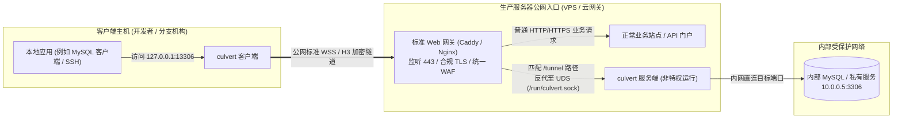
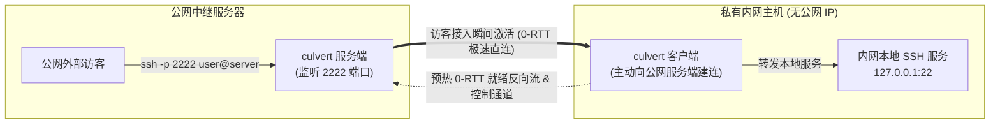
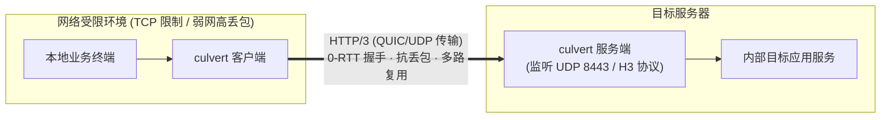

# culvert

> **面向标准化与合规服务器的高性能透明 TCP 隧道工具**  
> 基于 Rust 构建，支持 WebSocket、HTTP/3 (QUIC) 以及 Unix Domain Socket 传输，兼具极速连接与优雅架构。

[English](README.md) | 简体中文

[](https://opensource.org/licenses/MPL-2.0)
[](https://www.rust-lang.org)
[](.)

---

## 目录

- [设计理念](#设计理念)
- [核心亮点](#核心亮点)
- [网络拓扑与典型场景](#网络拓扑与典型场景)
- [快速上手](#快速上手)
- [命令行指南](#命令行指南)
- [配置全面参考](#配置全面参考)
- [生产部署指南（Caddy / Nginx / Systemd）](#生产部署指南)
- [常见场景配置示例](#常见场景配置示例)
- [常见问题与排障 (FAQ)](#常见问题与排障-faq)
- [合规使用警示与免责声明](#合规使用警示与免责声明)
- [开源协议](#开源协议)

---

## 设计理念

在企业级生产环境或合规服务器中，网络架构的规范性、安全边界的清晰度以及运维的可持续性至关重要。`culvert` 的诞生源于对传统隧道工具架构痛点的深入反思与实践重构。

### 1. 适合在标准化、合规的服务器上部署

- **告别“反客为主”的脆弱伪装**：许多传统隧道或代理软件倾向于大而全的单体设计，往往要求直接占用公网核心端口（80/443），置于 Web 服务之前，并在自身内部实现复杂的协议伪装与回落（fallback）机制。这种做法在合规生产环境中存在明显弊端：需要赋予软件特权端口监听权限、TLS 证书管理黑盒化、无法与企业的统一 WAF/CDN/审计系统协同，且一旦伪装层出现指纹缺陷极易引发不可预知的安全风险。
- **优雅置于标准 Web 服务之后**：`culvert` 坚持标准化的**后置部署架构**。推荐部署于 Caddy、Nginx 等成熟合规的 Web 网关之后，通过 Unix Domain Socket (UDS) 或本地回环端口接入：
  - **合规前置托管**：公网 80/443 端口由标准 Web 服务器统一监听，统一负责自动化 ACME 证书签发与续期、访问日志审计与防火墙防护。
  - **最小权限与安全隔离**：`culvert` 完全可以以受限的非特权系统用户（如 `culvert` 用户）运行，不暴露额外的外部公网监听端口，攻击面最小化。
  - **精准天然分流**：常规流量正常访问 Web 站点，只有当路径匹配（如 `/tunnel`）且携带有效鉴权令牌时，才被网关安全地反向代理至 `culvert`。

### 2. 专注基础 TCP 隧道，坚守 Unix 管道哲学

- **最小职责原则**：`culvert` 专注于提供底层透明、低延迟、高吞吐的 TCP 端口转发（Opaque Byte Stream），不内置复杂的 SOCKS5/HTTP 业务代理，不包含多余的应用层私有协议。
- **灵活串接与解耦**：需要上层鉴权、应用协议解析、流量审计或访问控制？只需利用标准网络栈将 `culvert` 与专业的第三方服务或工具串联即可。各个组件各司其职，保证系统架构的高内聚、低耦合与长久可维护性。

---

## 核心亮点

### 🌟 亮点一：支持 HTTP/3 (H3 / QUIC) 反代与 TCP 穿透（专为受限网络破局）

在实际网络运维中，常常会遭遇严苛的 TCP 连接限制：部分企业出口防火墙或运营商链路会对长时间运行的 TCP 连接进行频繁中断、限速或并发数压制；而在高延迟、高丢包的跨洋或弱网链路下，TCP 传统的拥塞控制与队头阻塞（Head-of-Line Blocking）会导致业务严重卡顿。

`culvert` 原生支持基于 QUIC 的 **HTTP/3 `CONNECT` 隧道协议**：

- **抗丢包与零队头阻塞**：基于 UDP 多路复用，某条流的偶发丢包绝不影响其他并发流的顺畅传输。
- **连接迁移 (Connection Migration)**：客户端网络在 Wi-Fi、蜂窝网络之间无缝切换时，长连接不中断。
- **极速握手**：享受 QUIC 的 0-RTT / 1-RTT 握手优势，在 TCP 严苛受限或弱网环境下表现极为出色。

### ⚡ 亮点二：独创 0-RTT Connection Pool（预热双向连接池）

常规隧道软件在客户端接收到新连接时，往往才临时向远端发起端到端握手（TCP 握手 + TLS 握手 + 协议协商），这会额外增加 1~3 个 RTT 的网络延迟，对 SSH 按键响应、MySQL 短查询等低延迟场景极不友好。

`culvert` 创新设计了**全链路双向预热连接池**：

- **正向模式 (Forward)**：客户端后台自动建立并预热维持一组就绪的空闲连接流。当本地新连接到达时，毫秒级从池中弹出可用流（0-RTT），通过微秒级带内激活报文（`0xA5` + 目标地址）瞬间开启转发，客户端后台并发平滑补充新空闲流。
- **反向模式 (Reverse)**：客户端主动向服务端预先建立反向就绪流并在服务端侧排队维护。公网访客接入服务端端口时，服务端秒级弹出可用流并通过单字节 `0xA5` 瞬间激活，无须等待控制信令握手往返，真正达成 0-RTT 极速响应！
- **完备的防风暴机制**：内置并发握手信号量（限制最大并发连接建立），避免在弱网断线重连时引发连接风暴；结合指数退避与服务端统一生命周期裁决，确保工业级稳定性。

---

## 网络拓扑与典型场景

### 场景一：标准 Web 服务后置反代（推荐的生产合规部署）

公网入口完全由标准 Web 服务器托管，`culvert` 作为非特权后端服务通过 Unix Domain Socket 挂载。



---

### 场景二：反向穿透场景（Reverse Tunnel，安全暴露 NAT 内网服务）

家庭、实验室或企业内网中没有公网 IP 的主机，通过 `culvert` 反向隧道安全暴露至公网服务器。



---

### 场景三：受限网络下的 HTTP/3 (QUIC) 极速直连场景

在 TCP 受到严重 QoS 限速、频繁重置或跨洋高丢包环境下，使用 HTTP/3 (QUIC/UDP) 建立可靠隧道。



---

## 协议与传输对照表

`server.listen` 与 `tunnels[].endpoint` 支持完全一致的 URL Scheme 集合：

| Scheme | 底层传输协议 | 默认端口 | 典型适用场景 |
| :--- | :--- | :--- | :--- |
| `ws` | WebSocket over TCP | 80 | 本地回环或与前端反代（Nginx/Caddy）配合使用 |
| `wss` | WebSocket over TCP + TLS | 443 | 穿越公网的标准安全传输 |
| `h3` / `https` | HTTP/3 (`CONNECT` over QUIC/UDP) | 443 | **TCP 连接受限、丢包严重或弱网环境** |
| `quic` | 原生 QUIC 双向流 | 443 | 追求极致性能的纯 UDP 双向流传输 |
| `ws+unix` | WebSocket over Unix Domain Socket | — | **推荐！本机 Caddy / Nginx 后置接入方式** |
| `wss+unix` | 带 TLS 的 Unix Domain Socket | — | 对本地套接字有额外加密要求的场景 |

> [!NOTE]
> Unix Socket URL 支持通过 Query 参数传递路径与文件权限，例如：  
> `ws+unix:///run/culvert.sock?path=/tunnel&chmod=0o660`  
> （其中 `chmod` 接受八进制格式，如 `660`、`0660` 或 `0o660`）。

### 端口映射模式说明

| 映射模式 (`mode`) | 监听端口位置 | 目标地址拨号端 | 预热连接池 (`pool_size`) | 典型用途 |
| :--- | :--- | :--- | :--- | :--- |
| `forward` (正向，默认) | 客户端本地主机 | 服务端远程网络 | 支持预热连接池共享 | 访问远程内网私有资源 (如数据库、后台) |
| `reverse` (反向) | 服务端公网主机 | 客户端本地网络 | 支持预热反向就绪池 (0-RTT) | 将内网本地服务暴露至公网 (如远程 SSH) |

---

## 快速上手

### 1. 编译安装

运行环境要求：Rust 1.85+（Edition 2024）与 C/C++ 工具链。

```bash
# 克隆仓库
git clone https://github.com/spritetong/culvert.git
cd culvert

# 编译优化版本
cargo build --release

# 编译产物位于: target/release/culvert
```

### 2. 静态配置检查

在启动前，建议使用 `--check` 选项静态验证配置文件格式是否规范：

```bash
target/release/culvert --check -c config.yaml
```

### 3. 最简正向穿透示例

**服务端配置 (`server.yaml`)** — 在中继服务器上运行：

```yaml
log:
  level: "info"

server:
  listen: "ws://0.0.0.0:8080/tunnel"
  token: "PLEASE_REPLACE_WITH_A_SECRET_TOKEN"
  default_target: "127.0.0.1:5201"
```

**客户端配置 (`client.yaml`)** — 在本地客户端运行：

```yaml
log:
  level: "info"

tunnels:
  - tag: "my-first-tunnel"
    endpoint: "ws://YOUR_SERVER_IP:8080/tunnel"
    token: "PLEASE_REPLACE_WITH_A_SECRET_TOKEN"
    mappings:
      - mode: "forward"
        listen: "127.0.0.1:18080"
        target: "127.0.0.1:8080"
```

分别启动服务端与客户端：

```bash
# 服务端执行
culvert -c server.yaml

# 客户端执行
culvert -c client.yaml

# 验证连通性：访问本地端口即直通远端
curl http://127.0.0.1:18080/
```

---

## 命令行指南

```text
culvert [OPTIONS]
```

| 参数 | 接收值 | 描述 | 默认值 |
| :--- | :--- | :--- | :--- |
| `-c`, `--config` | `<PATH>` | 指定 YAML 配置文件路径 | `config.yaml` |
| `-w`, `--worker-threads` | `<NUM>` | 指定 Tokio 工作线程数（`1` 为单线程运行时），覆盖文件配置 | 自动检测 CPU 核心数 |
| `--check` | 无 | 仅执行配置校验并退出，不绑定端口或启动运行时 | 关闭 |
| `-h`, `--help` | 无 | 显示命令行帮助文档 | — |
| `-V`, `--version` | 无 | 显示程序版本号 | — |

> [!TIP]
> 进程优雅停止策略：接收到第一个终止信号（SIGINT/SIGTERM）时，程序会取消所有异步任务并给予平滑退出窗口；若收到第二次信号，则立即以退出码 `130` 强制退出。

---

## 配置全面参考

配置文件采用标准 YAML 格式。`culvert` 采用严格的 Schema 校验（`deny_unknown_fields`），杜绝因配置键拼写失误造成的隐性异常。

### 1. 顶层配置 (Top-Level)

| 字段 | 类型 | 是否必填 | 默认值 | 说明 |
| :--- | :--- | :--- | :--- | :--- |
| `log` | 对象 | 否 | `level: info` | 日志系统设置。 |
| `worker_threads` | 整数 | 否 | 核心数 | Tokio 运行时工作线程数。须 `>= 1`。 |
| `dns` | 对象 | 否 | 系统解析 | 全局默认 DNS 解析策略与上游服务器。 |
| `dialer` | 对象 | 否 | 见下文 | 全局网络拨号与超时控制参数。 |
| `tls` | 对象 | 否 | — | 全局 TLS 证书、密钥与验证选项。 |
| `server` | 对象 | 否 | — | 服务端入口监听配置（与 `tunnels` 至少存在一项）。 |
| `tunnels` | 列表 | 否 | `[]` | 隧道客户端配置列表。 |

---

### 2. `log`（日志设置）

```yaml
log:
  level: "info"       # trace | debug | info | warn | error (优先级低于环境变量 RUST_LOG)
  output: "stdout"    # stdout | stderr
  no_color: false     # 是否关闭 ANSI 终端色彩
```

---

### 3. `dns`（DNS 解析与策略）

```yaml
dns:
  strategy: "prefer_ipv4"   # prefer_ipv4 | prefer_ipv6 | ipv4_only | ipv6_only
  cache_capacity: 1024      # DNS 缓存条目上限 (默认 TTL 为 300 秒)
  resolvers:
    - "system://0.0.0.0"                              # 系统默认解析
    - "udp://1.1.1.1:53"                              # 标准 UDP DNS
    - "tcp://1.1.1.1:53"                              # 标准 TCP DNS
    - "tls://8.8.8.8?sni=dns.google"                  # DNS-over-TLS (DoT)
    - "https://1.1.1.1/dns-query?sni=cloudflare-dns.com" # DNS-over-HTTPS (DoH)
```

---

### 4. `dialer`（网络拨号与保活）

```yaml
dialer:
  connect_timeout: "10s"      # TCP 连接建立超时
  tcp_nodelay: true           # 开启 TCP_NODELAY，消除小包延迟
  bind_interface: "eth0"      # 绑定指定出口网卡 (通过 SO_BINDTODEVICE，可选)
  heartbeat_interval: "15s"   # 链路空闲时的主动心跳探测间隔
  idle_timeout: "30s"         # 链路无读写数据的超时断开判定 (须大于 heartbeat_interval)
```

---

### 5. `tls`（TLS 加密与双向认证）

```yaml
tls:
  server_name: "tunnel.example.com"  # 强制覆盖 SNI 域名
  insecure: false                    # 是否跳过服务端证书校验 (开发测试使用)
  ca_certificate: "/path/to/ca.pem"  # 自定义受信任 CA 证书
  client_certificate: "/path/to/client.pem" # mTLS 客户端证书
  client_key: "/path/to/client.key"         # mTLS 客户端私钥
  min_version: "1.3"                 # 允许的最低 TLS 版本 (1.2 或 1.3)
  max_version: "1.3"                 # 允许的最高 TLS 版本 (1.2 或 1.3)
```

---

### 6. `server`（服务端入口）

```yaml
server:
  listen:
    - "ws+unix:///run/culvert.sock?path=/tunnel&chmod=0o660"
    - "wss://0.0.0.0:8443/tunnel"
    - "h3://0.0.0.0:8443/tunnel"
  token: "SECURE_AUTH_TOKEN"         # 预共享密钥 (最大 256 字节，非空)
  default_target: "127.0.0.1:5201"    # 默认兜底目标服务
  heartbeat_interval: "15s"          # 服务端连接心跳保活间隔
  idle_timeout: "30s"                # 服务端连接空闲超时
  # certificate: "/path/to/cert.pem" # TLS 证书路径 (若未提供且协议需要，将自动生成自签名证书)
  # key: "/path/to/key.pem"          # TLS 私钥路径
```

---

### 7. `tunnels[]`（客户端隧道集群）

```yaml
tunnels:
  - tag: "corp-internal"              # 隧道唯一标签
    endpoint: "wss://tunnel.example.com/tunnel" # 服务端 URL 或包含独立 dns/tls 的对象
    token: "SECURE_AUTH_TOKEN"        # 与服务端一致的验证令牌
    pool_size: 8                      # 开启 0-RTT 预热连接池大小 (正向与反向均支持)
    retry:
      delay: "3s"                     # 重连尝试固定间隔
      max_retries: 10                 # 最大重试次数 (缺省表示无限重试)
    mappings:
      - mode: "forward"               # 正向模式
        listen: "127.0.0.1:13306"
        target: "10.0.0.5:3306"
      - mode: "reverse"               # 反向模式
        listen: "0.0.0.0:2222"        # 在服务端绑定的监听端口
        target: "127.0.0.1:22"        # 客户端本地转发的目标端口
```

---

## 生产部署指南

### 1. Caddy 生产反代配置（推荐）

Caddy 原生支持自动化证书申请与 Unix Domain Socket 反代，与 `culvert` 的后置理念完美契合：

**`server.yaml`**：

```yaml
log:
  level: "info"
server:
  listen: "ws+unix:///run/culvert.sock?path=/tunnel&chmod=0o660"
  token: "CHANGE_TO_A_VERY_SECURE_TOKEN"
```

**`Caddyfile`**：

```caddy
tunnel.example.com {
    # 匹配专用隧道路径
    @tunnel path /tunnel
    handle @tunnel {
        reverse_proxy unix//run/culvert.sock {
            # 将 stream_timeout 保持为 0 (无限制)，维持长连接不被异常重置
        }
    }

    # 其余路径展示企业合规的正常 Web 页面或文档
    handle {
        respond "Welcome to Corporate Gateway. System status: Operational." 200
    }
}
```

---

### 2. Nginx 生产反代配置

如果服务器使用 Nginx，可以使用以下配置：

```nginx
# /etc/nginx/sites-available/tunnel.conf

server {
    listen 80;
    server_name tunnel.example.com;
    return 301 https://$host$request_uri;
}

server {
    listen 443 ssl http2;
    server_name tunnel.example.com;

    ssl_certificate /etc/letsencrypt/live/tunnel.example.com/fullchain.pem;
    ssl_certificate_key /etc/letsencrypt/live/tunnel.example.com/privkey.pem;

    # 常规 Web 业务
    location / {
        root /var/www/html;
        index index.html;
    }

    # culvert 隧道反代入口
    location = /tunnel {
        proxy_pass http://unix:/run/culvert.sock;
        
        # 确保 WebSocket 协议头正确转发
        proxy_http_version 1.1;
        proxy_set_header Upgrade $http_upgrade;
        proxy_set_header Connection "upgrade";
        proxy_set_header Host $host;

        # 保持隧道长连接不被超时断开
        proxy_read_timeout 3600s;
        proxy_send_timeout 3600s;
        proxy_buffering off;
    }
}
```

---

### 3. Linux Systemd 生产服务配置

为了保障 `culvert` 作为守护进程可靠稳定运行，建议配置 Systemd 服务单元文件。

创建运行用户并设置权限：

```bash
sudo useradd --system --shell /usr/sbin/nologin --user-group culvert
sudo mkdir -p /etc/culvert /run
sudo chown culvert:culvert /run
```

创建服务文件 `/etc/systemd/system/culvert.service`：

```ini
[Unit]
Description=culvert High-Performance TCP Tunnel Service
After=network.target network-online.target
Wants=network-online.target

[Service]
Type=simple
User=culvert
Group=culvert
ExecStart=/usr/local/bin/culvert -c /etc/culvert/server.yaml
Restart=on-failure
RestartSec=5s
LimitNOFILE=65535

# 安全沙箱保护
ProtectSystem=full
ProtectHome=true
NoNewPrivileges=true
PrivateTmp=true

[Install]
WantedBy=multi-user.target
```

加载并启动服务：

```bash
sudo systemctl daemon-reload
sudo systemctl enable --now culvert
sudo systemctl status culvert
```

---

## 常见场景配置示例

### 1. 反向发布内网 SSH 服务（带 0-RTT 预热就绪池）

客户端位于无公网 IP 的办公内网，将本地 SSH 服务注册到远端 VPS 上的 `2222` 端口：

```yaml
tunnels:
  - tag: "office-ssh"
    endpoint: "wss://tunnel.example.com/tunnel"
    token: "CHANGE_ME"
    pool_size: 4                     # 预热 4 条空闲反向流，访客连接 0-RTT 秒级就绪
    mappings:
      - mode: "reverse"
        listen: "0.0.0.0:2222"       # 在服务端绑定的监听端口
        target: "127.0.0.1:22"       # 客户端本地 SSH 端口
```

外部访客连接：

```bash
ssh -p 2222 user@tunnel.example.com
```

---

### 2. HTTP/3 直连直通高丢包网络

在没有标准 Web 网关或需要直穿 UDP 的场景下，服务端直接终结 HTTP/3：

**`server.yaml`**：

```yaml
server:
  listen:
    - "h3://0.0.0.0:8443/tunnel"
  token: "CHANGE_ME"
  # certificate 与 key 省略时，服务端将自动生成临时的自签名证书
```

**`client.yaml`**：

```yaml
tls:
  insecure: true                     # 当服务端使用自签名证书时开启
tunnels:
  - tag: "h3-fast-link"
    endpoint: "h3://YOUR_SERVER_IP:8443/tunnel"
    token: "CHANGE_ME"
    pool_size: 4
    mappings:
      - mode: "forward"
        listen: "127.0.0.1:13306"
        target: "127.0.0.1:3306"
```

---

### 3. 多端口集群共用单条隧道与连接池

一个隧道配置项下可以聚合多个正向与反向端口映射，支持绑定 TCP 端口或 Unix 域套接字（如 Docker daemon）：

```yaml
tunnels:
  - tag: "dev-cluster"
    endpoint: "wss://tunnel.example.com/tunnel"
    token: "CHANGE_ME"
    pool_size: 8
    mappings:
      # 正向访问远程开发机 MySQL
      - mode: "forward"
        listen: "127.0.0.1:13306"
        target: "10.0.0.5:3306"
      # 正向访问远程 Docker 守护进程
      - mode: "forward"
        listen: "127.0.0.1:18000"
        target: "unix:///var/run/docker.sock"
      # 反向暴露本地调试 Web 服务
      - mode: "reverse"
        listen: "0.0.0.0:8000"
        target: "127.0.0.1:3000"
```

---

## 常见问题与排障 (FAQ)

### Q1: 使用 Unix Domain Socket 时，前端反代报错 `Permission denied`？

**解答**：请检查 URL Query 中的 `chmod` 参数或套接字所在目录权限。推荐在 URL 后添加 `?chmod=0o660`，并确保 Caddy / Nginx 的运行用户与 `culvert` 用户属于同一用户组，例如：

```yaml
server:
  listen: "ws+unix:///run/culvert.sock?path=/tunnel&chmod=0o660"
```

### Q2: 隧道连接在空闲几分钟后总是被主动切断？

**解答**：通常是由反代服务器的默认超时设置引起的。

- 在 **Caddy** 中，请将 `reverse_proxy` 块的 `stream_timeout` 维持为 `0`（默认值即无限制）。
- 在 **Nginx** 中，请确保设置了 `proxy_read_timeout 3600s;` 与 `proxy_send_timeout 3600s;`。
- 同时确认配置中的 `dialer.heartbeat_interval`（默认 15s）正常工作，定时发送保活探测维持链路活性。

### Q3: 什么时候推荐使用 HTTP/3 (H3)，什么时候推荐 WebSocket (WSS)？

**解答**：

- **推荐 WSS 场景**：在标准云服务器生产环境、有成熟的 Caddy/Nginx 网关、需要复用 443 端口与合规 Web 站点共享入口时，WSS 后置反代是最佳选择。
- **推荐 H3 / QUIC 场景**：在 TCP 连接受到严格限制、长连接经常被强制重置、或者处于高丢包、高延迟的跨洋弱网链路时，HTTP/3 基于 UDP 的多路复用与抗丢包特性将带来显著的稳定性与吞吐提升。

---

## 合规使用警示与免责声明

> [!CAUTION]
>
> ### ⚠️ 合规使用严正警示
>
> 本项目定位为企业及开发者在**合法合规**前提下进行系统运维、内网调试、远程办公与网络传输优化的基础工具。
>
> **严禁**将 `culvert` 用于任何形式的网络攻击、网络黑灰产业、电信网络诈骗、侵入计算机信息系统、非法未授权接入、窃取数据或规避监管等违法犯罪活动。

### 免责声明 (Disclaimer)

1. **使用者责任**：使用者在下载、编译、安装和运行本软件之前，必须深入了解并无条件遵守所在国家和地区的相关法律、法规及网络管理政策。
2. **风险自负**：本软件按“原样”（AS-IS）提供，不附带任何明示或暗示的担保。使用本软件产生的任何直接或间接法律责任、民事侵权纠纷、行政处罚或经济损失，均由使用者自行完全承担。
3. **作者免责**：本项目作者及开源贡献者不对任何第三方或个人因滥用、不当配置或非法使用本软件造成的任何后果承担任何连带责任。

---

## 开源协议

本项目采用 [Mozilla Public License Version 2.0 (MPL-2.0)](LICENSE) 开源许可证。
详细架构设计可参阅 [DESIGN.md](docs/DESIGN.md) 与 [PRD.md](docs/PRD.md)。
