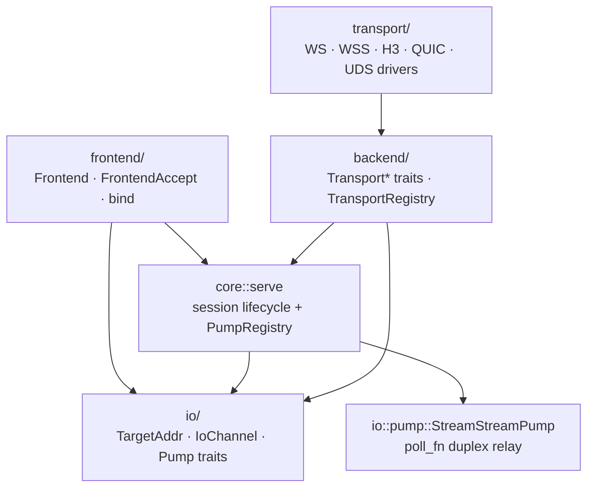

# Technical Design — culvert

| Field | Value |
| :--- | :--- |
| Document | Technical Design / Architecture Specification |
| Product | culvert (workspace version 0.1.0, Rust edition 2024, MPL-2.0) |
| Status | Current — describes the implemented code |
| Companion documents | [PRD.md](PRD.md), [README.md](../README.md) |
| Normative source | `crates/culvert/src`, `crates/culvert-cli/src`, `config-example.yaml` |

This document describes the implementation as it exists. It is not a roadmap:
modules, configuration fields, and protocols that are not part of the runtime
data path are listed in [Section 13](#13-not-wired-into-the-runtime-data-path).

---

## 1. Design Summary

culvert is a TCP port-forwarding daemon. A single process loads one YAML file,
optionally starts ingress listeners (`server`), optionally starts one or more
tunnel clients (`tunnels`), and supervises both. Traffic between a client and a
server travels over one of three relay drivers (WebSocket, HTTP/3/QUIC,
WebSocket over a Unix domain socket) as an opaque bidirectional byte stream.

The runtime is split into three independent parts. Independence means the core
depends **only** on the neutral `io` vocabulary — `core::serve` never names a
`Frontend` or `Transport*` trait. The runtime layers (`tunnel/`, `server/`)
build a `PumpRequest` from those traits and hand it to core. Adding a new
frontend capability (UDP port mapping) requires a new `Frontend` implementation
and a new `Pump` registration, not a change to core logic.

| Part | Owns | Module |
| :--- | :--- | :--- |
| **Frontend** | The mapping service exposed to the outside world. Today TCP and Unix domain sockets only. | `frontend/` |
| **Core** | Session lifecycle: pairing, activation, cancellation, retry, statistics, and `core::serve` pump dispatch. It never moves bytes itself. | `core/`, `tunnel/`, `session/`, `pool/`, `control/` |
| **Backend** | A uniform I/O interface over relay channels: WS, WSS, H3, QUIC, UDS, and future P2P/datagram transports. | `backend/` (traits + registry), `transport/` (drivers) |

`io/` is a shared vocabulary with no business logic: `TargetAddr`,
`L4Protocol`, `IoChannel`, `TunnelStream`, `TunnelError`, `PumpCtx`, and the
capability types. All three parts depend on `io/`; none of them depends on
another part's implementation. `platform/` holds OS-level socket primitives
wrapped by the TCP frontend, `config/` holds the declarative schema, and
`daemon` + `supervisor` + `common::task` own process lifecycle (one cancellation
token, owned tasks, cancel then await).

The reverse control plane (`control/`, `session/`, `pool/`) is **stream-scoped**
today: activation bytes, `x-session-id` pairing, and idle-stream heartbeats only
exist for connection-oriented relays. It is orchestration, not the byte-moving
core, and it is reached only through `IoChannel`'s stream variant. A datagram
frontend does not pass through it; it goes straight to its own `Pump`.



`core::serve(req: PumpRequest, ctx: PumpCtx)` looks up a `Pump` by
`(req.frontend.kind(), req.backend.kind())` in a process-wide `PumpRegistry` and
delegates the transfer. Core contains no `match` on channel variants and no
byte-copying code. `StreamStreamPump` is the only registered pump today; its body
is the hand-written `poll_fn` duplex state machine. A datagram frontend would
register a second pump without touching `serve`. See
[Section 5.7](#57-three-layer-boundaries-and-the-pump-registry).

---

## 2. Repository Layout

```
Cargo.toml                     workspace: crates/culvert, crates/culvert-cli
config-example.yaml            canonical configuration example
crates/culvert-cli/src/main.rs CLI, logging setup, Tokio runtime, --check
crates/culvert/src/
  lib.rs                       public re-exports and run_* entry points
  consts.rs                    all constants and defaults
  io/
    mod.rs                     neutral vocabulary re-exports
    addr.rs                    L4Protocol, MappingSpec, TargetAddr, parse_target_addr
    channel.rs                 FlowKey, ChannelKind, IoChannel, DatagramIo
    stream.rs                  TunnelStream, StreamCaps, liveness helpers
    error.rs                   TunnelError, is_permanent, is_shutdown
    pump.rs                    Pump, PumpRegistry, PumpCtx, StreamStreamPump
  frontend/
    mod.rs                     Frontend, FrontendAccept, FrontendRegistry, bind
    tcp.rs                     TcpFrontend (TCP + Unix domain sockets)
  backend/
    mod.rs                     TransportConnector/Listener/Driver, StreamMetadata
    registry.rs                TransportRegistry scheme dispatch
  core/
    serve.rs                   core::serve pump dispatch
    error.rs, stream.rs        compatibility re-exports from io/
    failover.rs                standalone module, not used by the data path
  config/{model,loader}.rs     schema, deserializers, validation
  daemon.rs                    signal handling and hard shutdown deadline
  supervisor/runner.rs         TunnelSupervisor
  client/runner.rs             ClientRunner and fixed-delay retry loop
  server/runner.rs             ingress accept loop and stream dispatch
  tunnel/{cluster,forward,reverse}.rs
  pool/connection_pool.rs      ReplenishingStreamPool actor
  control/stream.rs            MessagePack control protocol
  session/manager.rs           reverse data-stream pairing
  dialer/{endpoint,dns,tls,unified}.rs
  transport/                   backend driver implementations only
    mod.rs                     re-exports backend traits, driver modules
    ws/{mod,connector,listener,model,stream}.rs
    h3/{mod,connector,listener,stream}.rs
    uds.rs
  platform/{mod,unix,windows}.rs  UDS listener, target dialing, OS primitives
  common/{auth,cancel,net,task}.rs
  mux/                         standalone module, not used by the data path
crates/culvert/tests/          end-to-end and regression tests
```

The workspace has two crates: `culvert` (library) and `culvert-cli` (binary
named `culvert`). The binary uses the library through `culvert::run_daemon`.

---

## 3. Startup and Process Lifecycle

1. `Cli::parse()` reads `--config / -c`, `--worker-threads / -w`, and
   `--check`.
2. `ConfigLoader::from_file` parses YAML into `AppConfig` and runs
   `validate()`. Errors are printed to stderr and exit with code `1`.
3. `--check` prints a success line and returns without initializing logging,
   binding sockets, or starting the runtime. It is a static check only.
4. Logging is initialized with `tracing_subscriber`; `EnvFilter` from `RUST_LOG`
   takes precedence over `log.level`. Output goes to stdout or stderr; ANSI is
   controlled by `log.no_color`.
5. The Tokio runtime is built from `-w` or `worker_threads`: `1` selects
   `new_current_thread`, an explicit `n` selects `new_multi_thread` with
   `worker_threads(n)`, and absence selects `new_multi_thread` with
   auto-detected cores.
6. `run_daemon(app_config)` resets the shared shutdown deadline, creates the
   root `CancellationToken`, spawns the shutdown handler, and calls
   `TunnelSupervisor::run()`.

### 3.1 Shutdown

- `spawn_shutdown_handler` owns a signal task and a dedicated OS-thread
  watchdog (`shutdown-watchdog`). The thread exists so a hard deadline can fire
  even if every Tokio worker is busy.
- First termination signal: cancel the root token, notify the watchdog to
  start a 10-second deadline (`DEFAULT_SHUTDOWN_HARD_DEADLINE`). Second signal:
  exit with code `130`.
- `ShutdownWatchdog::finish()` disarms the deadline and joins both owned
  handles; it is called on every daemon exit path, including clean exits.
- `TaskTracker::shutdown_and_wait()` cancels child tokens and awaits the
  `JoinSet`. Nested trackers share one absolute 5-second grace deadline
  (`DEFAULT_GRACE_PERIOD`) rather than compounding windows. `abort_all()` is
  only the deadline fallback, and even then every handle is awaited.
- Design constraint: no task is detached on the normal path. Every tracked task
  observes the cancellation token and every await is cancellation-aware or has
  an explicit timeout. Listeners expose an async `shutdown()`; `Drop` is only
  an abnormal-path safety net.

---

## 4. Configuration Model

### 4.1 Schema

`AppConfig` is `#[serde(deny_unknown_fields)]`; all nested configuration
structs are too. `EndpointConfig` and `DnsResolverConfig` implement custom
`deserialize_any` visitors to accept either a string or a structured map.

| Section | Type | Purpose |
| :--- | :--- | :--- |
| `log` | `LogConfig` (defaulted) | `level`, `output`, `no_color`. |
| `worker_threads` | `Option<usize>` | Tokio worker count; `0` rejected. |
| `dns` | `Option<DnsConfig>` | `strategy`, `resolvers`, `cache_capacity`. |
| `dialer` | `Option<DialerConfig>` | `connect_timeout`, `tcp_nodelay`, `bind_interface`, `heartbeat_interval`, `idle_timeout`. |
| `tls` | `Option<TlsConfig>` | `server_name`, `insecure`, `alpn`, `ca_certificate`, `client_certificate`, `client_key`, `certificate`, `key`, `min_version`, `max_version`. |
| `server` | `Option<ServerConfig>` | `listen`, `token`, `default_target`, `certificate`, `key`, `tls`, `heartbeat_interval`, `idle_timeout`. |
| `tunnels` | `Vec<TunnelConfig>` (defaulted) | `tag`, `endpoint`, `token`, `pool_size`, `failover`, `multiplex`, `retry`, `mappings`. |

`TunnelConfig` requires at least one `PortMappingConfig { mode, listen,
target }`; `mode` defaults to `forward`. `TunnelRetryConfig { delay,
max_retries }` uses a separate duration deserializer that accepts seconds,
`Ns`, or `Nms`.

Durations (`dialer`, `server`, `retry`) accept a raw integer (seconds) or a
string with `s` / `ms` suffix through `humantime_serde_opt` and the retry
duration helper.

### 4.2 URL parsing

`ServerListenSpec::parse` requires an explicit `://` and lowercase scheme.
For TCP schemes it splits `host:port` from the HTTP path, requires a non-zero
`u16` port, and stores the path as `None` when it is `/`. For UDS schemes it
normalizes the socket path, parses `?path=` (prepending `/` if needed) and
`?chmod=` (always octal, `<= 0o7777`).

`dialer::endpoint::Endpoint::parse` uses the `url` crate for `ws`, `wss`,
`https`, `h3`, `quic`, and a dedicated path parser for `ws+unix` / `wss+unix`.
Default ports are 80 for `ws` and 443 for the TLS/QUIC schemes. A UDS endpoint
must include a socket file path.

`io::addr::TargetAddr` has three variants: `Ip(SocketAddr)`,
`Domain(String, u16)`, `Path(PathBuf)`. `io::addr::parse_target_addr` accepts
`unix://path`, bracketed IPv6 with port, `ip:port`, or a validated
`hostname:port`. A port is mandatory and non-zero for non-UDS forms. Both live
in the neutral vocabulary layer: config, frontend, core, and backend refer to
the same type without any of them owning it.

`io::addr::L4Protocol` is `Tcp | Udp`. `io::addr::MappingSpec { protocol,
listen, target }` is the neutral description of one port mapping handed to
`frontend::bind`. `run_forward_mapping` builds the spec with
`MappingSpec::tcp` from the `listen` / `target` strings returned by
`TunnelConfig::canonical_mappings()`. `PortMappingConfig` has no `protocol`
field and the configuration schema has no UDP constructor. UDP port mapping is
not implemented in this release.

### 4.3 EndpointContext merge

`EndpointContext::build(endpoint_cfg, app_config)` produces the effective
runtime context for one endpoint:

```
Endpoint { scheme, host, port, path, query }
dns_resolver   : CachedDnsResolver from effective DnsConfig
dialer         : DefaultDialer from effective DialerConfig + resolver
dialer_config  : effective DialerConfig (used for heartbeat/idle/connect timeouts)
tls_config     : Option<TlsConfig>
http_headers   : Option<HashMap<String, String>>
```

Merge order for `dns`, `dialer`, and `tls` fields is
**endpoint override → global → built-in default**. TLS is activated purely by
the scheme (`https`, `wss`, `h3`, `quic`, `wss+unix`); a `tls` block on any
other scheme is an error. When no SNI is configured, the endpoint host is used.
`http_headers` merges tunnel-level headers over endpoint-level headers,
overriding keys case-insensitively. A configured `Host` header overrides the
default `host:port` authority.
Helpers `heartbeat_interval()`, `idle_timeout()`, and `connect_timeout()`
return the effective values used by runtime timers.

### 4.4 Validation rules

`ConfigLoader::validate` is executed at every startup and by `--check`:

- At least one server listener or one tunnel must exist. Empty `{}` fails.
- `worker_threads >= 1`; log level in `trace|debug|info|warn|error`; output in
  `stdout|stderr`.
- Tokens are non-empty and at most 256 bytes (`TOKEN_MAX_LEN`).
- `pool_size >= 1`, `retry.delay > 0`, `retry.max_retries > 0`,
  `dns.cache_capacity >= 1`.
- `http_headers` header names and values are validated fail-fast: header names
  cannot be empty and must conform to RFC 9110 token syntax; values must not
  contain forbidden control characters or CRLF injection.
- Server `default_target` parses; `certificate` and `key` come as a pair and
  PEM files are readable and valid; certificates are rejected if every
  listener is plaintext.
- TLS version strings are `1.2` or `1.3` and the min is not above max.
  mTLS certificate/key and CA files are validated.
- All mapping `listen` / `target` values parse; forward listen addresses are
  unique across all tunnels; tunnel tags are unique and non-empty.
- Endpoint schemes are in the supported set; detailed endpoints may not
  configure `tls` on a non-TLS scheme; all DNS resolvers parse;
  `EndpointContext::build` succeeds.
- Effective `idle_timeout > heartbeat_interval` after defaults are merged,
  checked for global dialer, server, and each tunnel.
- `multiplex` and `failover` sections are rejected unconditionally with a
  message stating they are not wired into the data path.

---

## 5. Transport Layer

### 5.1 Backend traits

`backend/mod.rs` owns the relay-channel interface; `transport/` contains only
driver implementations and re-exports these traits for existing import paths.
`backend/registry.rs` owns `TransportRegistry`.

```rust
// backend/mod.rs
pub struct StreamMetadata {
    pub mode: TunnelMode,
    pub session_id: Option<String>,
    pub target: Option<TargetAddr>,
    pub pool_idle: bool,
}
pub type AcceptOutput = Result<(IoChannel, StreamMetadata), TunnelError>;

pub trait TransportConnector: Send + Sync {
    fn connect<'a>(&'a self, target: &'a TargetAddr,
                   session_id: Option<&'a str>)
        -> BoxFuture<'a, Result<IoChannel, TunnelError>>;
    fn connect_pooled<'a>(&'a self, target: &'a TargetAddr)
        -> BoxFuture<'a, Result<IoChannel, TunnelError>>;
    fn invalidate_broken_sessions(&self) {}
}

pub trait TransportListener: Send + Sync {
    fn accept(&mut self, slot: &mut ReusableFutureRef<'static, AcceptOutput>);
    fn shutdown<'a>(&'a mut self) -> BoxFuture<'a, ()>;
}

pub trait TransportDriver: Send + Sync + 'static {
    fn schemes(&self) -> &[&'static str];
    fn build_connector(&self, endpoint: &EndpointContext, auth_token: &str,
                       mode: TunnelMode) -> Result<Box<dyn TransportConnector>, TunnelError>;
    fn build_listener(&self, listen_addr: &str, auth_token: Option<&str>,
                      path: Option<&str>, tls: Option<&TlsConfig>,
                      cancel: CancellationToken)
                      -> Result<Box<dyn TransportListener>, TunnelError>;
}
```

`BoxFuture` is a boxed, `Send`, lifetime-bound future; the traits avoid
`async_trait`. `connect_pooled` is required: the old default silently omitted
the `x-tunnel-pool: idle` marker and produced a normal data stream. There is a
single `build_listener` carrying the root `CancellationToken`; the previous
`build_listener` / `build_listener_with_cancel` pair and its legacy fallback are
gone. `protocol_scheme()` was removed — it had no call sites. The single-shot
`accept_one` helper for `TransportListener` is a free function in `backend`,
not a trait default; `GenericListener` keeps its own concrete convenience
method.
`TransportListener::shutdown()` is the explicit async termination boundary for
listener-owned tasks.

`IoChannel` is the one I/O product both sides hand to core. It implements
`AsyncRead`, `AsyncWrite`, and `TunnelStream` by delegating to its stream
variant, so the stream-only control plane (pool, session manager, control
framing) keeps its borrowed-style calls. `IoChannel::into_stream()` is the
explicit by-value conversion used when a boxed stream is required; on a
datagram channel it returns `TunnelError::UnsupportedChannel`. This is the only
place the backend can grow a second I/O shape, and it is shared by `connect`
and `accept`.

### 5.2 TunnelStream and stream capabilities

`io::stream::TunnelStream` extends `AsyncRead + AsyncWrite + Send + Unpin +
'static` with liveness hooks and one capability query:

```rust
pub struct StreamCaps { pub owned_write: bool, pub half_close: bool }
// Default: owned_write = false, half_close = true.
pub trait TunnelStream: AsyncRead + AsyncWrite + Send + Unpin + 'static {
    fn caps(&self) -> StreamCaps;
    fn poll_write_owned(&mut self, cx: &mut Context<'_>, chunk: Bytes)
        -> Poll<io::Result<usize>>;   // default: poll_write(cx, &chunk)
    fn poll_send_ping(&mut self, cx: &mut Context<'_>) -> Poll<io::Result<()>>;
    fn last_activity_ms(&self) -> Option<u64>;
    fn poll_check_alive(&mut self, cx: &mut Context<'_>) -> Poll<HeartbeatStatus>;
}
```

`StreamStreamPump` reads `caps()` once per direction and selects the owned or
borrowed write path; `caps().half_close` replaces the old
`supports_half_close()` method. The previous pair
`consumes_owned_write()` + `poll_write_bytes()` was replaced by this single
query so that the owned path cannot be left unselected: `WsTunnelStream` had a
zero-copy owned write implementation that the relay never called.
`poll_write_owned` keeps a borrowed default because byte-oriented transports
(TCP, TLS, QUIC) have nothing to retain; it is only invoked when
`owned_write` is true.

`BufferedTlsStream` (one-byte pushback) is still present: TLS drivers require
it. `impl TunnelStream for Box<dyn TunnelStream>` was removed because no
production path boxes a boxed stream; `IoChannel` is the only forwarding layer
in the data path.

`heartbeat_timing(last_activity_ms, now, heartbeat_interval, idle_timeout)`
computes whether a probe is needed. Probes never refresh liveness by
themselves; inbound frames and real outbound data do.

WebSocket has no native transport-level half-close; culvert encodes half-close
FIN as an in-band zero-length binary frame (`caps().half_close == true`).
`poll_check_alive(cx)` uses a zero-capacity `ReadBuf` to drive the underlying
`poll_read` state machine non-destructively, ensuring that in-band FIN frames and
in-flight data frames are never swallowed during idle liveness sweeps.

Liveness is a read-side question. A local half-close (`fin_queued` / `fin_sent`)
or a queued RFC 6455 Close reply means "this direction cannot write any more",
not "the stream is dead": the relay sets those flags as soon as one direction
drains and may still be streaming the opposite direction for a long time.
Reporting `Dead` in that window aborts the relay with "unresponsive to
heartbeats" and truncates the response. Only a failed write half
(`WriteState::Failed`) or a broken/failed read state is fatal. The hook never
polls the in-flight write future itself: `poll_read` performs the opportunistic
control flush, and `poll_check_alive` inspects the write state it leaves behind.
`poll_send_ping` likewise stops emitting probes after a local FIN, without
marking the stream dead.

### 5.3 Driver registry

`backend::registry::TransportRegistry::default()` (re-exported from
`transport::registry`) registers three drivers:

| Driver | Schemes | Implementation |
| :--- | :--- | :--- |
| `WsTransportDriver` | `ws`, `wss` | `hyper` HTTP/1.1 + `fastwebsockets` Upgrade; `WsTunnelStream`. Optional rustls TLS. |
| `H3TransportDriver` | `h3`, `https`, `quic` | `quinn` + `h3`; `H3TunnelStream` for CONNECT streams, `QuinnTunnelStream` for raw bidirectional streams. |
| `UdsTransportDriver` | `ws+unix`, `wss+unix` | HTTP/1.1 Upgrade over a Unix domain socket; optional TLS; `chmod` handling. |

`create_connector` dispatches by `EndpointContext.endpoint.scheme`;
`create_listener` dispatches by the parsed `ServerListenSpec.scheme` and passes
the root cancellation token. Unsupported schemes return
`TunnelError::UnsupportedScheme`.

### 5.4 Handshake metadata

| Header | Meaning |
| :--- | :--- |
| `x-tunnel-auth` | Pre-shared token on WebSocket/UDS; also sent by HTTP/3 clients. |
| `authorization: Bearer …` | Pre-shared token on HTTP/3 `CONNECT` requests. |
| `x-tunnel-mode` | `forward`, `reverse-ctrl`, `reverse-data`. |
| `x-session-id` | Reverse data-stream pairing key. |
| `x-target-host`, `x-target-port`, `x-target-path` | Split target form (WebSocket/UDS). |
| `x-tunnel-target` | Unified `TargetAddr` string (HTTP/3). |
| `x-tunnel-pool: idle` | Marks a pre-warmed stream awaiting activation. |

`WsHandshakeHeaders` encodes and decodes these headers and produces
`StreamMetadata`. On HTTP/3 listeners, equivalent headers are read from the
`CONNECT` request. On raw QUIC, the same `StreamMetadata` is serialized with
MessagePack and sent in a length-prefixed handshake:

```
4 bytes auth_len (big-endian) | auth_token bytes
4 bytes meta_len (big-endian) | MessagePack(StreamMetadata)
```

The server caps `auth_len` at 1024 bytes and `meta_len` at 65536 bytes.

### 5.5 Ingress acceptance

- WebSocket/UDS listeners check the request path first (`404` on mismatch),
  then parse handshake headers (`401` on malformed), then compare the token in
  constant time (`403` on mismatch), then perform the HTTP Upgrade. Invalid
  upgrade requests get `400`.
- HTTP/3 listeners check the path (`404`), read the token from `authorization`
  first and fall back to `x-tunnel-auth` (`401`), accepting a raw token or a
  `Bearer `-prefixed value, parse mode/target/session/pool headers, and respond
  `200 OK` before relaying.
- Raw QUIC listeners compare the token from the binary handshake in constant
  time and close the stream on mismatch; no HTTP headers are involved.
- `common::auth::constant_time_token_eq` copies both values into fixed 256-byte
  buffers, hashes them with SHA-256, and compares with `subtle::ConstantTimeEq`;
  values longer than 256 bytes are rejected without early length leakage.

### 5.6 TLS, DNS, and dialing

- `dialer::tls::TlsConfigBuilder` builds rustls client and server configs. It
  loads a custom CA, mTLS client certificate/key, applies version bounds and
  ALPN, installs a no-verification verifier when `insecure` is set, and
  generates an ephemeral self-signed certificate (`rcgen`) when no server
  certificate/key pair is provided.
- ALPN defaults: `h3` for HTTP/3 endpoints, `culvert-quic` for raw QUIC. The
  H3 listener ensures `h3` is first in the server ALPN list and adds
  `culvert-quic` for `quic://` listeners.
- `dialer::dns::CachedDnsResolver` wraps `hickory-resolver`, with a bounded
  cache (1024 entries, 300 s TTL) and a system/libc fallback. Resolver types
  are `system`, `udp`/`dns`, `tcp`, `tls` (DoT), `https` (DoH). Structured
  objects and URL strings (`system://0.0.0.0`, `udp://1.1.1.1:53`,
  `https://1.1.1.1?sni=cloudflare-dns.com`, `tls://8.8.8.8?sni=dns.google`,
  `tcp://…`) are both accepted.
- `dialer::unified::DefaultDialer` resolves the endpoint host, applies the
  configured strategy, races multiple addresses with RFC 8305 staggering
  (250 ms), applies `connect_timeout`, `tcp_nodelay`, and `bind_interface`.
  `common::net::tune_tcp_stream` only sets `TCP_NODELAY`.
  `bind_interface` requires `SO_BINDTODEVICE` and is rejected elsewhere by
  `platform::validate_bind_interface`.
- `platform::GenericListener` is either `Tcp(Arc<TcpListener>)` or
  `Uds(Arc<Mutex<PlatformUdsListener>>)`. `frontend::tcp::TcpFrontend` is the
  only wrapper that exposes it to the runtime, and it implements `Frontend`;
  both forward and reverse port listeners go through `frontend::bind`, so no
  runtime module binds a mapping listener directly. `normalize_uds_path` handles
  `unix://`, `ws+unix://`, `wss+unix://`, query strings, and drive-letter paths.
  The Windows UDS listener uses `uds_windows`, WSA events, and a dedicated OS
  accept thread whose handle is owned and joined.

### 5.7 Three-layer boundaries and the Pump registry

This section defines "independent". The dependency rule is one-way:
`frontend/`, `backend/`, and `core/` each depend on `io/`; none of them imports
another part's implementation. `io/` contains no business logic and no
reference to a concrete driver. `transport/` drivers implement
`TransportDriver` and never appear in `core/`.

```rust
// io/channel.rs
pub enum ChannelKind { Stream, Datagram }
pub enum IoChannel {
    Stream(Box<dyn TunnelStream>),
    Datagram(Box<dyn DatagramIo>),
}
pub struct FlowKey { pub peer: String, pub target: Option<TargetAddr>, pub protocol: L4Protocol }
pub struct Datagram { pub flow: FlowKey, pub payload: Bytes }
pub trait DatagramIo: Send + Unpin + 'static {
    fn poll_recv(&mut self, cx: &mut Context<'_>, batch: &mut [Datagram])
        -> Poll<io::Result<usize>>;
    fn poll_send(&mut self, cx: &mut Context<'_>, batch: &[Datagram])
        -> Poll<io::Result<usize>>;
}

// io/pump.rs
pub struct PumpRequest { pub frontend: IoChannel, pub backend: IoChannel }
pub struct PumpCtx {
    pub cancel: CancellationToken,
    pub heartbeat_interval: Duration,
    pub idle_timeout: Duration,
}
pub trait Pump: Send + Sync + 'static {
    fn run<'a>(&'a self, req: PumpRequest, ctx: PumpCtx)
        -> BoxFuture<'a, Result<(u64, u64), TunnelError>>;
}
pub struct PumpRegistry; // register(kind_pair, pump), lookup(kind_pair)
pub fn pump_registry() -> &'static PumpRegistry;

// core/serve.rs
pub async fn serve(req: PumpRequest, ctx: PumpCtx)
    -> Result<(u64, u64), TunnelError>;
```

`serve` computes `(req.frontend.kind(), req.backend.kind())`, asks
`PumpRegistry::lookup`, and returns `TunnelError::UnsupportedChannel` when no
pump is registered. It contains no `match` on `IoChannel` variants and no
read/write calls. `PumpRegistry` is a process-wide
`RwLock<HashMap<(ChannelKind, ChannelKind), Arc<dyn Pump>>>` seeded at first use
with `StreamStreamPump` for `(Stream, Stream)`; `register()` is the extension
point. `FlowKey` identifies one datagram flow and lives on each `Datagram`.

The frontend is an abstraction, not a concrete enum:

```rust
// frontend/mod.rs
pub struct FrontendAccept {
    pub channel: IoChannel,
    pub peer: String,
}
pub trait Frontend: Send {
    fn accept(&mut self, slot: &mut ReusableFutureRef<'static, Result<FrontendAccept, TunnelError>>);
    fn shutdown<'a>(&'a mut self) -> BoxFuture<'a, ()>;
}
pub async fn bind(spec: &MappingSpec) -> Result<Box<dyn Frontend>, TunnelError>;
```

`Frontend` does not declare a channel kind: `IoChannel::kind()` on the accepted
channel is the single authoritative key that `core::serve` dispatches on, so a
declared kind could not drift out of sync with what the frontend actually
yields. `FrontendAccept` carries no `FlowKey` either — stream flows use `peer`,
and datagram flows carry their key per envelope in `Datagram.flow`.

`frontend::bind` consults a `FrontendRegistry` keyed by `L4Protocol`. Only
`Tcp` is registered; a `Udp` spec returns `TunnelError::UnsupportedChannel`
before any socket is created. `run_forward_mapping` builds the spec with
`MappingSpec::tcp`; `canonical_mappings()` only supplies the `listen` and
`target` strings, with no protocol field in `PortMappingConfig`.

**Adding UDP port mapping later** requires a `UdpFrontend` registered in
`FrontendRegistry`, a datagram-capable `TransportDriver` that yields
`IoChannel::Datagram`, and a `StreamDatagramPump` / `DatagramDatagramPump`
registered in `PumpRegistry`. No file under `core/` changes. UDP port mapping
itself is **not implemented** in this release; only these extension points
exist.

---

## 6. Server Data Path

`ServerRunner::run` parses `ServerListenSpec`s, spawns one accept-loop task per
listener with the effective server TLS config, heartbeat interval, and idle
timeout, and tracks accepted connections in a nested `TaskTracker`.

For each accepted `(channel, StreamMetadata)` — an `IoChannel` from the backend
and its handshake metadata:

| `metadata.mode` | Branch |
| :--- | :--- |
| `Forward` | Resolve the target, dial it, relay. |
| `Reverse` with `session_id` | Fulfill a pending reverse session in `SessionManager`. |
| `Reverse` with `pool_idle` | Enqueue idle stream into the corresponding reverse listener's inbound pool via `SessionManager`. |
| `Reverse` (control) | Run the reverse control channel handler. |

Forward target resolution order:

1. `dynamic_target` from the activation packet (pooled stream only).
2. `metadata.target` unless it is the pool dummy host `pool.idle`.
3. `server.default_target`.

If none is available the stream is closed with a log message. Dialing uses
`platform::connect_target`. Both sides are wrapped as `IoChannel` and handed to
`core::serve(req, ctx)`, which dispatches `StreamStreamPump`. Stream-only
branches (control framing, session fulfillment, idle pools) call
`channel.into_stream()` at their own boundary.

### 6.1 Activation packet

```
0xA5 | length: u16 big-endian | UTF-8 target string (Forward mode only)
```

- In **Forward mode**: Produced by `ReplenishingStreamPool::encode_activation` on
  the client, written before any application data. The server reads the magic
  byte, then the length and payload with a 10-second timeout, rejects lengths
  `>= 512`, parses the string with `parse_target_addr`, and only then dials the
  target. An invalid magic byte or a closed idle stream terminates that connection.
- In **Reverse mode**: The server sends a single `0xA5` byte directly down the
  popped idle reverse stream to trigger activation on the client. Target address
  is already statically configured on the client.

### 6.2 Reverse control channel & Inbound Pool

`handle_reverse_control` wraps the accepted stream in `FramedControlStream`,
reads `RegisterReverse { listen_addr, target_addr, pool_size }`, binds the
requested listener through `frontend::bind(&MappingSpec::tcp(...))`, registers
an `inbound_pool` with
`SessionManager` **before** replying `RegisterAck` (the client starts
pre-warming immediately on the ack), and starts accepting inbound connections.
`pool_size` is the effective, already-clamped worker count, so the server's
soft cap is derived from the same number the client uses; the field is
`#[serde(default)]` for interoperability with older peers. Registration of a
new generation drains the previous pool, closing its stale idle streams.
Teardown removes the pool only if it is still the same `Arc`, so an overlapping
reconnect cannot delete the new generation.

In the event loop, `ctrl_stream.next()` is prioritized above `listener.accept()`
in `biased; select!`: this guarantees that control frames (such as keepalive
`Ping` and `Pong`) are never starved during heavy visitor floods, preventing
false 30-second idle timeout disconnections.

For each inbound connection on the reverse listener:

1. **Fast path (0-RTT Pool)**: `pop_live(idle_timeout)` takes the newest idle
   stream, drops entries older than the effective idle window, and verifies the
   rest with `poll_check_alive`. To eliminate WAN RTT latency from the accept
   loop, stream activation (`write_all(&[ACTIVATE_STREAM_MAGIC])` and `flush()`)
   is offloaded directly into the spawned relay task in `local_tracker`. The
   accept loop returns in 0 ms, allowing hundreds of visitors to be paired in
   parallel without blocking subsequent accepts.
2. **Fallback path (On-demand Signaling)**: If no live stream is available
   (empty pool, stale entries, or `pool_size` not set), the server allocates a
   session id (`REVERSE_SESSION_COUNTER`), registers a oneshot receiver in
   `SessionManager`, and sends `NewConnection`. The frame send is bounded by
   `reverse_frame_timeout(idle_timeout)` (10 s by default); if sending times out
   on a congested channel, the visitor session is dropped and the accept loop
   continues without tearing down the listening port. The paired data stream is
   delivered by `SessionManager::fulfill`; pairing is bounded by
   `DEFAULT_SESSION_PAIR_TIMEOUT` (15 s). Both channels then go to `core::serve`.

The control loop also handles `Ping`/`Pong` and reconnect with exponential
backoff.

`FramedControlStream` is a `tokio_util::codec::LengthDelimitedCodec` over any
`AsyncRead + AsyncWrite` stream, implementing `Stream<Item =
Result<ControlMessage, TunnelError>>` and `Sink<ControlMessage>` with
`rmp_serde::to_vec_named` / `from_slice`.

---

## 7. Client Data Path

`ClientRunner::run` builds an `EndpointContext` for each tunnel and spawns one
`run_tunnel_with_retry` worker. `run_tunnel_cluster` creates the shared pool
and spawns one task per mapping.

### 7.1 Forward mapping

`run_forward_mapping` builds a `MappingSpec` (always `L4Protocol::Tcp`) and
calls `frontend::bind`. For each `FrontendAccept` it either acquires a stream
from the shared pool or calls `TransportConnector::connect(&target, None)` on a
connector shared by the mapping. If a pooled stream was acquired, the activation
packet is written and flushed first. Both channels are then passed to
`core::serve`. An `ActiveStreamGuard` calls `pool.on_stream_closed()` on drop.

### 7.2 Reverse mapping

`run_reverse_mapping` opens the control channel with dummy target
`control:0`, sends `RegisterReverse`, awaits `RegisterAck`, and then loops on
control messages.

When `pool_size` is configured, `clamp_reverse_pool_size` caps it at
`POOL_MAX_CAPACITY` = 64 and one worker per slot maintains a pre-warmed idle
stream connected to the server (`mode = Reverse`, `pool_idle = true`,
`target = listen_addr`). The worker waits cancellably for the `0xA5` activation
byte and reaps its own relay tasks while waiting. It has **no independent
recycle timer**: the server is the sole owner of an idle stream's lifetime, so
a worker can never close a connection the server has already popped and
committed to a visitor. Expiry, overflow eviction, re-registration and listener
teardown all close idle streams from the server side; the worker sees EOF and
re-dials. Upon activation it dials the local `mappings.target`, hands `core::serve`
to its own `TaskTracker` (never detached), and immediately dials a replacement
— one dial RTT, with no server-side "pool low" message. Pre-warm dials are
throttled to at most `POOL_MAX_CONCURRENT_CONNECTS` = 16 concurrent handshakes
via a shared semaphore, protecting low-bandwidth links from connection storms.
Dial failures back off exponentially from 200 ms up to 10 s (`POOL_BACKOFF_MAX`),
capped at 1 s (`POOL_BACKOFF_ACTIVE_WAITERS_MAX`) when requests await replenishment,
with worker-index stagger to prevent lockstep retries.

Because each consumed slot is replenished by its own worker, an extra server
signaling round trip would be strictly slower; the control channel is reserved
for visitors that actually find the pool empty.

On `NewConnection` (the signaling fallback path), it continues to dial the local
`mappings.target`, opens a `reverse-data` stream with the session id, and calls
`core::serve`. Reconnect backoff starts at 500 ms, doubles up to 30 s, and
resets after 30 s of stable operation.

### 7.3 Retry supervision

```
loop:
  run_tunnel_cluster(...)
  Ok / Shutdown                     -> exit
  error while cancelled             -> exit
  permanent error                   -> return error, no retry
  attempts >= max_retries           -> return error
  sleep_or_cancel(retry.delay)      -> next attempt
```

`retry.delay` is a fixed configured delay (default 3 s), not an exponential
backoff. `retry.max_retries` is optional; omitting it retries indefinitely.
`TunnelError::is_permanent()` covers `Config`, `UnsupportedScheme`,
`UnsupportedChannel`, `AuthFailed`, and `Tls`.

---

## 8. Connection Pool

`ReplenishingStreamPool` is a channel-driven actor. `new_shared` connects idle
streams without a fixed target so forward mappings can activate any target
later.

| Element | Behavior |
| :--- | :--- |
| `mpsc::Sender<PoolCommand>` | `Acquire`, `PushIdle`, `StreamClosed` / `ActiveReleased` on a 1024-slot channel. |
| `idle_streams: VecDeque<ManagedStream>` | Idle streams with per-stream `HeartbeatState`. |
| `pending_requests: VecDeque<AcquireRequest>` | Waiters with timestamps; each has a `oneshot` reply. |
| `connecting_futures: FuturesUnordered` | At most 16 concurrent dials (`POOL_MAX_CONCURRENT_CONNECTS`). |
| Reactor events | `Cancelled`, `ConnectionResult`, `Command`, `RetryTimerExpired`, `HeartbeatTick`, `StreamsEvicted`. |
| Heartbeats | `poll_check_alive` sweeps on a 1-second tick with a 5-second probe interval and 5-second probe timeout. Non-destructive via zero-capacity read buffer. |
| Acquire order | LIFO (freshest first) to avoid silently expired NAT/QUIC pinholes. A stream with an in-flight probe write (`HeartbeatState::SendingPing`) is skipped but kept in the pool; only over-age or `poll_check_alive == Dead` streams are evicted. Shared transport sessions are invalidated once per Acquire and only after a real eviction, so a healthy-but-busy stream cannot close the cached QUIC/H3 connection and its sibling multiplexed streams. |
| Replenishment | Parallel one-turn batch dialing up to `POOL_MAX_CONCURRENT_CONNECTS` (16); backoff from 200 ms up to 10 s, capped at 1 s when waiters are queued (`POOL_BACKOFF_ACTIVE_WAITERS_MAX`). |
| Limits | Idle pre-warmed inventory bounded by `POOL_MAX_CAPACITY` = 64; `pool_size` acts as the 0-RTT minimum warm inventory floor. Active relay throughput is fully decoupled from replenishment gating; pending callers dial immediately in parallel batches up to 16. Acquire timeout 15 s. |
| Statistics | `PoolStats { idle_count, active_count, total_created }`. Authoritative `active_count` is tracked atomically (`Arc<AtomicUsize>`). |

Idle pooled streams are opened with the `pool.idle` dummy target and
`x-tunnel-pool: idle`; the server never dials a backend for them. Acquired
streams are **one-shot**: they are not returned to the idle queue after the
relay ends. `ActiveStreamGuard` decrements the atomic active counter on drop and
sends an `ActiveReleased` hint to wake the reactor. Cancelled `acquire()` requests
restore any already-acquired idle stream back into the pool or hand it directly to
waiting callers instead of discarding it. There is no draining/return protocol.

`pool::connection_pool.rs` also contains `StreamPool` / `InMemoryStreamPool`,
a simple standalone implementation; the runtime data path uses
`ReplenishingStreamPool`.

---

## 9. Stream/Stream Pump

`io::pump::StreamStreamPump` implements `Pump` for `(Stream, Stream)`. Its
`relay_with_heartbeat(a, b, token, heartbeat_interval, idle_timeout)` maintains
two `TransferState` values (64 KB buffer each, from `RELAY_BUFFER_SIZE`) inside
one `poll_fn`:

```
TransferState {
    buffer, read_pos, write_pos,
    in_flight_chunk: Option<Bytes>, chunk_pos,
    read_done, write_shutdown, total_bytes,
}
```

On each poll it checks the cancellation future, polls reads and writes for both
directions, flushes owned `Bytes` chunks via `poll_write_owned` when
`caps().owned_write` is true, drives activity-gated `poll_send_ping`, and
terminates a direction only after its buffered bytes are flushed and its write
side is shut down (`caps().half_close`). `caps()` is read once per direction
before the loop, not on every poll. On cancellation it allows a bounded 500 ms
drain (`DEFAULT_RELAY_DRAIN_TIMEOUT`) for in-flight tails. The return value is
`(bytes_a_to_b, bytes_b_to_a)`.

`Pump::run` calls `IoChannel::into_stream()` on both sides once, then runs this
state machine. No other pump is registered in this release.

Design constraint: this hot path is intentionally a hand-written `poll_fn`
state machine. Replacing it with `tokio::select!` is not permitted because of
the measured performance impact. Fairness/hand-written priority behavior in
this loop and in the pool reactor is deliberately retained.

---

## 10. Session Pairing and Inbound Pools

`SessionManager` manages two dispatch tables:

1. **On-demand Sessions**: A `DashMap<String, oneshot::Sender<Box<dyn TunnelStream>>>`.
   When no idle stream is available, the server calls `register(session_id)`,
   waits up to 15 s (`DEFAULT_SESSION_PAIR_TIMEOUT`), and the reverse data stream
   is delivered by `fulfill(session_id, stream)`. `remove` clears timed-out
   entries.
2. **Reverse Inbound Pools**: A `DashMap<String, Arc<ReverseInboundPool>>` keyed
   by the canonical `TargetAddr` string (host **and** port or UDS path, so two
   listeners sharing a port on different local addresses never collide).
   Pre-warmed reverse streams (`mode = Reverse`, `pool_idle = true`,
   `target = listen_addr`) are enqueued via `push_idle_stream`; a known target
   that matches no pool is dropped rather than guessed into another listener's
   pool. Each queue is LIFO with a soft cap of
   `reverse_pool_soft_cap(pool_size) = 2 x` the negotiated worker count:
   overflow evicts the oldest entry, tolerating one overlapping reconnect
   generation while preventing unbounded growth. Entries carry their enqueue
   time; `pop_live(idle_timeout)` lazily closes over-age entries (the only
   practical defence against a silently expired NAT/QUIC pinhole, since
   `poll_check_alive` reports `Pending` as healthy) and skips EOF/dead streams.
   Both eviction and expiry act only on entries still in the queue: `pop_back`
   removes a stream under the same lock before the activation byte is written,
   so a committed stream can never be evicted. `drain()` closes a superseded
   generation on re-registration; listener teardown immediately drops the listening
   socket and unregisters the pool before awaiting in-flight visitor relays, freeing
   the port without delay so reconnecting peers never hit port conflicts. Teardown
   is identity-checked with `remove_if`.

Errors are `SessionNotFound`, `SessionClosed`, and `SessionPairTimeout`. This
whole section is stream-scoped: it is the reverse control plane, not the
byte-moving core. Datagram flows do not use `SessionManager` or
`ReverseInboundPool`; they are handled entirely by their registered `Pump`.

---

## 11. Error Model

`io::error::TunnelError` (re-exported as `core::error::TunnelError`) includes
`Io`, `UrlParse`, `Config`, `UnsupportedScheme`, `UnsupportedChannel`,
`DnsResolutionFailed`, `DnsNoAddresses`, `Tls`, `TlsHandshake`,
`ConnectTimeout`, `AuthFailed`, `SessionNotFound`, `SessionClosed`,
`SessionPairTimeout`, `ControlProtocol`, `Multiplex`, `PoolExhausted`,
`Shutdown`, `Internal`. `UnsupportedChannel` reports an unregistered pump pair,
a missing frontend protocol, or `into_stream()` on a datagram channel; it is
permanent.

`is_permanent()` and `is_shutdown()` drive the supervisor's retry and shutdown
decisions. `common::cancel` provides `CancelFutureExt::cancel_with`,
`CancellationTokenExt::sleep_or_cancel`, and `TimeoutOrCancel`, which give
every await an explicit cancellation or timeout boundary.

---

## 12. Constants and Defaults

Selected values from `consts.rs`; all runtime timers come from these or from
effective configuration values.

| Constant | Value |
| :--- | :--- |
| `RELAY_BUFFER_SIZE` | 65536 |
| `TOKEN_MAX_LEN` | 256 bytes |
| `DEFAULT_CONNECT_TIMEOUT` | 10 s |
| `DEFAULT_HANDSHAKE_TIMEOUT` | 15 s |
| `DEFAULT_HEARTBEAT_INTERVAL` | 15 s |
| `DEFAULT_IDLE_TIMEOUT` | 30 s |
| `DEFAULT_RETRY_DELAY` | 3 s |
| `DEFAULT_SESSION_PAIR_TIMEOUT` | 15 s |
| `DEFAULT_ACTIVATION_READ_TIMEOUT` | 10 s |
| `DEFAULT_RELAY_DRAIN_TIMEOUT` | 500 ms |
| `DEFAULT_GRACE_PERIOD` | 5 s (shared absolute deadline) |
| `DEFAULT_SHUTDOWN_HARD_DEADLINE` | 10 s |
| `POOL_ACQUIRE_TIMEOUT` | 15 s |
| `POOL_MAX_CAPACITY` / `POOL_MAX_CONCURRENT_CONNECTS` | 64 / 16 |
| `POOL_HEARTBEAT_TICK_INTERVAL` / `POOL_HEARTBEAT_INTERVAL` | 1 s / 5 s |
| `POOL_BACKOFF_BASE` / `POOL_BACKOFF_MAX` / `ACTIVE_WAITERS_MAX` | 200 ms / 10 s / 1 s |
| `DEFAULT_REVERSE_BACKOFF_INITIAL` / `MAX` / reset | 500 ms / 30 s / 30 s |
| `MAX_ACTIVATION_TARGET_LEN` | 512 bytes |
| `ACTIVATE_STREAM_MAGIC` | `0xA5` |
| `ALPN_H3` / `ALPN_QUIC` | `h3` / `culvert-quic` |
| QUIC windows | stream 4 MiB, connection 128 MiB, send 128 MiB |
| QUIC keep-alive / max idle | 5 s / 30 s |
| DNS cache capacity / TTL | 1024 entries / 300 s |

---

## 13. Not Wired Into the Runtime Data Path

| Item | Location | Status |
| :--- | :--- | :--- |
| `MultiplexConfig` | `config/model.rs` | Rejected by `ConfigLoader::validate`. |
| `FailoverConfig` | `config/model.rs` | Rejected by `ConfigLoader::validate`. |
| `mux/` (frame, session, stream) | `crates/culvert/src/mux/` | Standalone module with its own tests; no data-path references to `MuxSession`. |
| `core/failover.rs` | `crates/culvert/src/core/` | Not referenced by config or runtime. |
| `L4Protocol::Udp` mapping | `io/addr.rs` | Vocabulary only. No config field, no `UdpFrontend`, no UDP socket. |
| `IoChannel::Datagram` | `io/channel.rs` | Variant and `DatagramIo` trait only. No driver constructs it. |
| Datagram pumps | `io/pump.rs` | `(Stream, Datagram)` / `(Datagram, Datagram)` are unregistered; `core::serve` returns `UnsupportedChannel`. |

Consequently there is no UDP port mapping, no seamless transport migration, no
primary/standby endpoint switching, no stream-offset replay buffer, no
P2P/STUN/ICE path, and no automatic HTTP/3-to-WSS fallback. Each tunnel uses
exactly the scheme in its endpoint URL. The three items above are **extension
points**, not partial implementations: the structural split is complete and
UDP port mapping is deliberately deferred so the split can be validated first.

---

## 14. Public Library API

```rust
// lib.rs
pub use client::ClientRunner;
pub use daemon::run_daemon;
pub use server::ServerRunner;
pub use supervisor::TunnelSupervisor;

pub async fn run_server(config: ServerConfig, cancel_token: CancellationToken)
    -> Result<(), TunnelError>;
pub async fn run_client(tunnel: TunnelConfig, cancel_token: CancellationToken)
    -> Result<(), TunnelError>;
pub async fn run(config: AppConfig, cancel_token: CancellationToken)
    -> Result<(), TunnelError>;
```

All modules are public. `io/` exports the neutral vocabulary (`TargetAddr`,
`L4Protocol`, `MappingSpec`, `IoChannel`, `DatagramIo`, `StreamCaps`,
`TunnelError`, `Pump`, `PumpRequest`, `PumpCtx`, `pump_registry`,
`StreamStreamPump`); `frontend/` exports `Frontend`, `FrontendAccept`, and
`bind`; `backend/` exports the `Transport*` traits and `TransportRegistry`;
`core::serve` is the pump-dispatch entry point. `ConfigLoader`,
`ReplenishingStreamPool`, and the protocol types are also usable directly.
Callers own the `CancellationToken` and are responsible for cancelling and
awaiting.

---

## 15. Verification

- `cargo test --workspace` runs unit tests in the config model/loader,
  control protocol, auth, session manager, task tracker, daemon watchdog, and
  the end-to-end tests in `crates/culvert/tests/`.
- `config-example.yaml` is asserted to parse cleanly by
  `config::loader::tests::test_load_config_example_file`.
- `culvert --check -c config-example.yaml` exercises the same validation path
  as startup without binding any address.
- Benchmarks live in `crates/culvert/benches/tunnel_benchmark.rs` and
  `benchmarks/`; they are development tooling, not a specification of
  throughput or latency.
