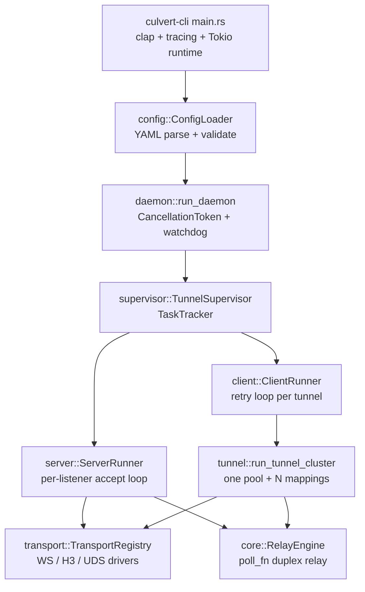

# Technical Design — culvert

| Field | Value |
| :--- | :--- |
| Document | Technical Design / Architecture Specification |
| Product | culvert (workspace version 0.1.0, Rust edition 2024, MPL-2.0) |
| Status | Current — describes the implemented code |
| Companion documents | [PRD.md](PRD.md), [README.md](../README.md) |
| Normative source | `crates/culvert/src`, `crates/culvert-cli/src`, `config-example.yaml` |

This document describes the implementation as it exists. It is not a roadmap:
modules, configuration fields, and protocols that are not part of the runtime
data path are listed in [Section 13](#13-not-wired-into-the-runtime-data-path).

---

## 1. Design Summary

culvert is a TCP port-forwarding daemon. A single process loads one YAML file,
optionally starts ingress listeners (`server`), optionally starts one or more
tunnel clients (`tunnels`), and supervises both. Traffic between a client and a
server travels over one of three transport drivers (WebSocket, HTTP/3/QUIC,
WebSocket over a Unix domain socket) as an opaque bidirectional byte stream.

The design is organized around four boundaries:

1. **Configuration boundary** — `config::model` + `config::loader`: strict
   schema, fail-fast validation.
2. **Transport boundary** — `transport::*` traits + `TransportRegistry`:
   scheme dispatch with no transport-specific logic in the tunnel layer.
3. **Session boundary** — `tunnel::*` + `pool::*` + `control::*` +
   `session::*`: mapping lifecycles, pre-warmed streams, reverse signaling.
4. **Lifecycle boundary** — `daemon` + `supervisor` + `common::task`: one
   cancellation token, owned tasks, cancellation then await.



---

## 2. Repository Layout

```
Cargo.toml                     workspace: crates/culvert, crates/culvert-cli
config-example.yaml            canonical configuration example
crates/culvert-cli/src/main.rs CLI, logging setup, Tokio runtime, --check
crates/culvert/src/
  lib.rs                       public re-exports and run_* entry points
  consts.rs                    all constants and defaults
  config/{model,loader}.rs     schema, deserializers, validation
  daemon.rs                    signal handling and hard shutdown deadline
  supervisor/runner.rs         TunnelSupervisor
  client/runner.rs             ClientRunner and fixed-delay retry loop
  server/runner.rs             ingress accept loop and stream dispatch
  tunnel/{cluster,forward,reverse}.rs
  pool/connection_pool.rs      ReplenishingStreamPool actor
  core/{error,stream,relay,failover}.rs
  control/stream.rs            MessagePack control protocol
  session/manager.rs           reverse data-stream pairing
  dialer/{endpoint,dns,tls,unified}.rs
  transport/
    mod.rs, registry.rs        traits, metadata, driver registry
    ws/{mod,connector,listener,model,stream}.rs
    h3/{mod,connector,listener,stream}.rs
    uds.rs
  platform/{mod,unix,windows}.rs  GenericListener, UDS listener, target parsing
  common/{auth,cancel,net,task}.rs
  mux/                         standalone module, not used by the data path
crates/culvert/tests/          end-to-end and regression tests
```

The workspace has two crates: `culvert` (library) and `culvert-cli` (binary
named `culvert`). The binary uses the library through `culvert::run_daemon`.

---

## 3. Startup and Process Lifecycle

1. `Cli::parse()` reads `--config / -c`, `--worker-threads / -w`, and
   `--check`.
2. `ConfigLoader::from_file` parses YAML into `AppConfig` and runs
   `validate()`. Errors are printed to stderr and exit with code `1`.
3. `--check` prints a success line and returns without initializing logging,
   binding sockets, or starting the runtime. It is a static check only.
4. Logging is initialized with `tracing_subscriber`; `EnvFilter` from `RUST_LOG`
   takes precedence over `log.level`. Output goes to stdout or stderr; ANSI is
   controlled by `log.no_color`.
5. The Tokio runtime is built from `-w` or `worker_threads`: `1` selects
   `new_current_thread`, an explicit `n` selects `new_multi_thread` with
   `worker_threads(n)`, and absence selects `new_multi_thread` with
   auto-detected cores.
6. `run_daemon(app_config)` resets the shared shutdown deadline, creates the
   root `CancellationToken`, spawns the shutdown handler, and calls
   `TunnelSupervisor::run()`.

### 3.1 Shutdown

- `spawn_shutdown_handler` owns a signal task and a dedicated OS-thread
  watchdog (`shutdown-watchdog`). The thread exists so a hard deadline can fire
  even if every Tokio worker is busy.
- First termination signal: cancel the root token, notify the watchdog to
  start a 10-second deadline (`DEFAULT_SHUTDOWN_HARD_DEADLINE`). Second signal:
  exit with code `130`.
- `ShutdownWatchdog::finish()` disarms the deadline and joins both owned
  handles; it is called on every daemon exit path, including clean exits.
- `TaskTracker::shutdown_and_wait()` cancels child tokens and awaits the
  `JoinSet`. Nested trackers share one absolute 5-second grace deadline
  (`DEFAULT_GRACE_PERIOD`) rather than compounding windows. `abort_all()` is
  only the deadline fallback, and even then every handle is awaited.
- Design constraint: no task is detached on the normal path. Every tracked task
  observes the cancellation token and every await is cancellation-aware or has
  an explicit timeout. Listeners expose an async `shutdown()`; `Drop` is only
  an abnormal-path safety net.

---

## 4. Configuration Model

### 4.1 Schema

`AppConfig` is `#[serde(deny_unknown_fields)]`; all nested configuration
structs are too. `EndpointConfig` and `DnsResolverConfig` implement custom
`deserialize_any` visitors to accept either a string or a structured map.

| Section | Type | Purpose |
| :--- | :--- | :--- |
| `log` | `LogConfig` (defaulted) | `level`, `output`, `no_color`. |
| `worker_threads` | `Option<usize>` | Tokio worker count; `0` rejected. |
| `dns` | `Option<DnsConfig>` | `strategy`, `resolvers`, `cache_capacity`. |
| `dialer` | `Option<DialerConfig>` | `connect_timeout`, `tcp_nodelay`, `bind_interface`, `heartbeat_interval`, `idle_timeout`. |
| `tls` | `Option<TlsConfig>` | `server_name`, `insecure`, `alpn`, `ca_certificate`, `client_certificate`, `client_key`, `certificate`, `key`, `min_version`, `max_version`. |
| `server` | `Option<ServerConfig>` | `listen`, `token`, `default_target`, `certificate`, `key`, `tls`, `heartbeat_interval`, `idle_timeout`. |
| `tunnels` | `Vec<TunnelConfig>` (defaulted) | `tag`, `endpoint`, `token`, `pool_size`, `failover`, `multiplex`, `retry`, `mappings`. |

`TunnelConfig` requires at least one `PortMappingConfig { mode, listen,
target }`; `mode` defaults to `forward`. `TunnelRetryConfig { delay,
max_retries }` uses a separate duration deserializer that accepts seconds,
`Ns`, or `Nms`.

Durations (`dialer`, `server`, `retry`) accept a raw integer (seconds) or a
string with `s` / `ms` suffix through `humantime_serde_opt` and the retry
duration helper.

### 4.2 URL parsing

`ServerListenSpec::parse` requires an explicit `://` and lowercase scheme.
For TCP schemes it splits `host:port` from the HTTP path, requires a non-zero
`u16` port, and stores the path as `None` when it is `/`. For UDS schemes it
normalizes the socket path, parses `?path=` (prepending `/` if needed) and
`?chmod=` (always octal, `<= 0o7777`).

`dialer::endpoint::Endpoint::parse` uses the `url` crate for `ws`, `wss`,
`https`, `h3`, `quic`, and a dedicated path parser for `ws+unix` / `wss+unix`.
Default ports are 80 for `ws` and 443 for the TLS/QUIC schemes. A UDS endpoint
must include a socket file path.

`TargetAddr` has three variants: `Ip(SocketAddr)`, `Domain(String, u16)`,
`Path(PathBuf)`. `parse_target_addr` accepts `unix://path`, bracketed IPv6 with
port, `ip:port`, or a validated `hostname:port`. A port is mandatory and
non-zero for non-UDS forms.

### 4.3 EndpointContext merge

`EndpointContext::build(endpoint_cfg, app_config)` produces the effective
runtime context for one endpoint:

```
Endpoint { scheme, host, port, path, query }
dns_resolver   : CachedDnsResolver from effective DnsConfig
dialer         : DefaultDialer from effective DialerConfig + resolver
dialer_config  : effective DialerConfig (used for heartbeat/idle/connect timeouts)
tls_config     : Option<TlsConfig>
```

Merge order for `dns`, `dialer`, and `tls` fields is
**endpoint override → global → built-in default**. TLS is activated purely by
the scheme (`https`, `wss`, `h3`, `quic`, `wss+unix`); a `tls` block on any
other scheme is an error. When no SNI is configured, the endpoint host is used.
Helpers `heartbeat_interval()`, `idle_timeout()`, and `connect_timeout()`
return the effective values used by runtime timers.

### 4.4 Validation rules

`ConfigLoader::validate` is executed at every startup and by `--check`:

- At least one server listener or one tunnel must exist. Empty `{}` fails.
- `worker_threads >= 1`; log level in `trace|debug|info|warn|error`; output in
  `stdout|stderr`.
- Tokens are non-empty and at most 256 bytes (`TOKEN_MAX_LEN`).
- `pool_size >= 1`, `retry.delay > 0`, `retry.max_retries > 0`,
  `dns.cache_capacity >= 1`.
- Server `default_target` parses; `certificate` and `key` come as a pair and
  PEM files are readable and valid; certificates are rejected if every
  listener is plaintext.
- TLS version strings are `1.2` or `1.3` and the min is not above max.
  mTLS certificate/key and CA files are validated.
- All mapping `listen` / `target` values parse; forward listen addresses are
  unique across all tunnels; tunnel tags are unique and non-empty.
- Endpoint schemes are in the supported set; detailed endpoints may not
  configure `tls` on a non-TLS scheme; all DNS resolvers parse;
  `EndpointContext::build` succeeds.
- Effective `idle_timeout > heartbeat_interval` after defaults are merged,
  checked for global dialer, server, and each tunnel.
- `multiplex` and `failover` sections are rejected unconditionally with a
  message stating they are not wired into the data path.

---

## 5. Transport Layer

### 5.1 Traits

```rust
// transport/mod.rs
pub enum TargetAddr { Ip(SocketAddr), Domain(String, u16), Path(PathBuf) }

pub struct StreamMetadata {
    pub mode: TunnelMode,
    pub session_id: Option<String>,
    pub target: Option<TargetAddr>,
    pub pool_idle: bool,
}

pub trait TransportConnector: Send + Sync {
    fn connect<'a>(&'a self, target: &'a TargetAddr,
                   session_id: Option<&'a str>)
        -> BoxFuture<'a, Result<Box<dyn TunnelStream>, TunnelError>>;
    fn connect_pooled<'a>(&'a self, target: &'a TargetAddr) -> BoxFuture<'_, ...>;
    fn protocol_scheme(&self) -> &'static str;
    fn invalidate_broken_sessions(&self) {}
}

pub trait TransportListener: Send + Sync {
    fn accept<'a>(&'a mut self)
        -> BoxFuture<'a, Result<(Box<dyn TunnelStream>, StreamMetadata), TunnelError>>;
    fn shutdown<'a>(&'a mut self) -> BoxFuture<'a, ()>;
}

pub trait TransportDriver: Send + Sync + 'static {
    fn schemes(&self) -> &[&'static str];
    fn build_connector(&self, endpoint: &EndpointContext, auth_token: &str,
                       mode: TunnelMode) -> Result<Box<dyn TransportConnector>, TunnelError>;
    fn build_listener(&self, listen_addr: &str, auth_token: Option<&str>,
                      path: Option<&str>, tls: Option<&TlsConfig>)
                      -> Result<Box<dyn TransportListener>, TunnelError>;
    fn build_listener_with_cancel(&self, ..., cancel: CancellationToken) -> ...;
}
```

`BoxFuture` is a boxed, `Send`, lifetime-bound future; the traits avoid
`async_trait`. `TransportListener::shutdown()` is the explicit async
termination boundary for listener-owned tasks.

### 5.2 TunnelStream

`core::stream::TunnelStream` extends `AsyncRead + AsyncWrite + Send + Unpin +
'static` with:

| Method | Purpose |
| :--- | :--- |
| `consumes_owned_write()` | Selects the owned-`Bytes` write path. |
| `poll_write_bytes(cx, Bytes)` | Writes an owned chunk without copying into a borrowed buffer. |
| `poll_send_ping(cx)` | Emits a transport-level liveness probe. |
| `last_activity_ms()` | Timestamp for activity-gated probes. |
| `poll_check_alive(cx)` | Returns `HeartbeatStatus` for idle-stream eviction. |
| `supports_half_close()` | Whether the transport can shut down one write direction. |

`heartbeat_timing(last_activity_ms, now, heartbeat_interval, idle_timeout)`
computes whether a probe is needed. Probes never refresh liveness by
themselves; inbound frames and real outbound data do.

### 5.3 Driver registry

`TransportRegistry::default()` registers three drivers:

| Driver | Schemes | Implementation |
| :--- | :--- | :--- |
| `WsTransportDriver` | `ws`, `wss` | `hyper` HTTP/1.1 + `fastwebsockets` Upgrade; `WsTunnelStream`. Optional rustls TLS. |
| `H3TransportDriver` | `h3`, `https`, `quic` | `quinn` + `h3`; `H3TunnelStream` for CONNECT streams, `QuinnTunnelStream` for raw bidirectional streams. |
| `UdsTransportDriver` | `ws+unix`, `wss+unix` | HTTP/1.1 Upgrade over a Unix domain socket; optional TLS; `chmod` handling. |

`create_connector` dispatches by `EndpointContext.endpoint.scheme`;
`create_listener` dispatches by the parsed `ServerListenSpec.scheme` and passes
the root cancellation token. Unsupported schemes return
`TunnelError::UnsupportedScheme`.

### 5.4 Handshake metadata

| Header | Meaning |
| :--- | :--- |
| `x-tunnel-auth` | Pre-shared token on WebSocket/UDS; also sent by HTTP/3 clients. |
| `authorization: Bearer …` | Pre-shared token on HTTP/3 `CONNECT` requests. |
| `x-tunnel-mode` | `forward`, `reverse-ctrl`, `reverse-data`. |
| `x-session-id` | Reverse data-stream pairing key. |
| `x-target-host`, `x-target-port`, `x-target-path` | Split target form (WebSocket/UDS). |
| `x-tunnel-target` | Unified `TargetAddr` string (HTTP/3). |
| `x-tunnel-pool: idle` | Marks a pre-warmed stream awaiting activation. |

`WsHandshakeHeaders` encodes and decodes these headers and produces
`StreamMetadata`. On HTTP/3 listeners, equivalent headers are read from the
`CONNECT` request. On raw QUIC, the same `StreamMetadata` is serialized with
MessagePack and sent in a length-prefixed handshake:

```
4 bytes auth_len (big-endian) | auth_token bytes
4 bytes meta_len (big-endian) | MessagePack(StreamMetadata)
```

The server caps `auth_len` at 1024 bytes and `meta_len` at 65536 bytes.

### 5.5 Ingress acceptance

- WebSocket/UDS listeners check the request path first (`404` on mismatch),
  then parse handshake headers (`401` on malformed), then compare the token in
  constant time (`403` on mismatch), then perform the HTTP Upgrade. Invalid
  upgrade requests get `400`.
- HTTP/3 listeners check the path (`404`), read the token from `authorization`
  first and fall back to `x-tunnel-auth` (`401`), accepting a raw token or a
  `Bearer `-prefixed value, parse mode/target/session/pool headers, and respond
  `200 OK` before relaying.
- Raw QUIC listeners compare the token from the binary handshake in constant
  time and close the stream on mismatch; no HTTP headers are involved.
- `common::auth::constant_time_token_eq` copies both values into fixed 256-byte
  buffers, hashes them with SHA-256, and compares with `subtle::ConstantTimeEq`;
  values longer than 256 bytes are rejected without early length leakage.

### 5.6 TLS, DNS, and dialing

- `dialer::tls::TlsConfigBuilder` builds rustls client and server configs. It
  loads a custom CA, mTLS client certificate/key, applies version bounds and
  ALPN, installs a no-verification verifier when `insecure` is set, and
  generates an ephemeral self-signed certificate (`rcgen`) when no server
  certificate/key pair is provided.
- ALPN defaults: `h3` for HTTP/3 endpoints, `culvert-quic` for raw QUIC. The
  H3 listener ensures `h3` is first in the server ALPN list and adds
  `culvert-quic` for `quic://` listeners.
- `dialer::dns::CachedDnsResolver` wraps `hickory-resolver`, with a bounded
  cache (1024 entries, 300 s TTL) and a system/libc fallback. Resolver types
  are `system`, `udp`/`dns`, `tcp`, `tls` (DoT), `https` (DoH). Structured
  objects and URL strings (`system://0.0.0.0`, `udp://1.1.1.1:53`,
  `https://1.1.1.1?sni=cloudflare-dns.com`, `tls://8.8.8.8?sni=dns.google`,
  `tcp://…`) are both accepted.
- `dialer::unified::DefaultDialer` resolves the endpoint host, applies the
  configured strategy, races multiple addresses with RFC 8305 staggering
  (250 ms), applies `connect_timeout`, `tcp_nodelay`, and `bind_interface`.
  `common::net::tune_tcp_stream` only sets `TCP_NODELAY`.
  `bind_interface` requires `SO_BINDTODEVICE` and is rejected elsewhere by
  `platform::validate_bind_interface`.
- `platform::GenericListener` is either `Tcp(TcpListener)` or
  `Uds(PlatformUdsListener)`. `normalize_uds_path` handles `unix://`,
  `ws+unix://`, `wss+unix://`, query strings, and drive-letter paths. The
  Windows UDS listener uses `uds_windows`, WSA events, and a dedicated OS
  accept thread whose handle is owned and joined.

---

## 6. Server Data Path

`ServerRunner::run` parses `ServerListenSpec`s, spawns one accept-loop task per
listener with the effective server TLS config, heartbeat interval, and idle
timeout, and tracks accepted connections in a nested `TaskTracker`.

For each accepted `(stream, StreamMetadata)`:

| `metadata.mode` | Branch |
| :--- | :--- |
| `Forward` | Resolve the target, dial it, relay. |
| `Reverse` with `session_id` | Fulfill a pending reverse session in `SessionManager`. |
| `Reverse` with `pool_idle` | Enqueue idle stream into the corresponding reverse listener's inbound pool via `SessionManager`. |
| `Reverse` (control) | Run the reverse control channel handler. |

Forward target resolution order:

1. `dynamic_target` from the activation packet (pooled stream only).
2. `metadata.target` unless it is the pool dummy host `pool.idle`.
3. `server.default_target`.

If none is available the stream is closed with a log message. Dialing uses
`platform::connect_target`, and relaying uses
`RelayEngine::relay_with_heartbeat(target_conn, stream, token, hb, idle)`.

### 6.1 Activation packet

```
0xA5 | length: u16 big-endian | UTF-8 target string (Forward mode only)
```

- In **Forward mode**: Produced by `ReplenishingStreamPool::encode_activation` on
  the client, written before any application data. The server reads the magic
  byte, then the length and payload with a 10-second timeout, rejects lengths
  `>= 512`, parses the string with `parse_target_addr`, and only then dials the
  target. An invalid magic byte or a closed idle stream terminates that connection.
- In **Reverse mode**: The server sends a single `0xA5` byte directly down the
  popped idle reverse stream to trigger activation on the client. Target address
  is already statically configured on the client.

### 6.2 Reverse control channel & Inbound Pool

`handle_reverse_control` wraps the accepted stream in `FramedControlStream`,
reads `RegisterReverse { listen_addr, target_addr, pool_size }`, binds the
requested listener on the server, registers an `inbound_pool` with
`SessionManager` **before** replying `RegisterAck` (the client starts
pre-warming immediately on the ack), and starts accepting inbound connections.
`pool_size` is the effective, already-clamped worker count, so the server's
soft cap is derived from the same number the client uses; the field is
`#[serde(default)]` for interoperability with older peers. Registration of a
new generation drains the previous pool, closing its stale idle streams.
Teardown removes the pool only if it is still the same `Arc`, so an overlapping
reconnect cannot delete the new generation.

For each inbound connection on the reverse listener:

1. **Fast path (0-RTT Pool)**: `pop_live(idle_timeout)` takes the newest idle
   stream, drops entries older than the effective idle window, and verifies the
   rest with `poll_check_alive`. The activation write and the `NewConnection`
   send share one derived `reverse_frame_timeout(idle_timeout)` — one third of
   the effective idle window, clamped to `[POOL_HEARTBEAT_TIMEOUT,
   DEFAULT_SESSION_PAIR_TIMEOUT]` and never longer than the idle window. With
   defaults this is 10 s, not a LAN-scale 2 s that would tear down the whole
   listener on a slow link. On failure the next candidate is tried; a stream
   that passes is relayed immediately with no control messages.
2. **Fallback path (On-demand Signaling)**: If no live stream is available
   (empty pool, stale entries, or `pool_size` not set), the server allocates a
   session id (`REVERSE_SESSION_COUNTER`), registers a oneshot receiver in
   `SessionManager`, and sends `NewConnection`. A stalled channel cannot block
   the accept loop indefinitely; on failure the listener closes and the client
   re-registers. The paired data stream is delivered by
   `SessionManager::fulfill`; pairing is bounded by
   `DEFAULT_SESSION_PAIR_TIMEOUT` (10 s). Both sides then relay.

The control loop also handles `Ping`/`Pong` and reconnect with exponential
backoff.

`FramedControlStream` is a `tokio_util::codec::LengthDelimitedCodec` over any
`AsyncRead + AsyncWrite` stream, implementing `Stream<Item =
Result<ControlMessage, TunnelError>>` and `Sink<ControlMessage>` with
`rmp_serde::to_vec_named` / `from_slice`.

---

## 7. Client Data Path

`ClientRunner::run` builds an `EndpointContext` for each tunnel and spawns one
`run_tunnel_with_retry` worker. `run_tunnel_cluster` creates the shared pool
and spawns one task per mapping.

### 7.1 Forward mapping

`run_forward_mapping` binds `mappings.listen` via `GenericListener::bind`. For
each inbound connection it either acquires a stream from the shared pool or
calls `TransportConnector::connect(&target, None)` on a connector shared by the
mapping. If a pooled stream was acquired, the activation packet is written and
flushed first. Both streams are then passed to `RelayEngine`. An
`ActiveStreamGuard` calls `pool.on_stream_closed()` on drop.

### 7.2 Reverse mapping

`run_reverse_mapping` opens the control channel with dummy target
`control:0`, sends `RegisterReverse`, awaits `RegisterAck`, and then loops on
control messages.

When `pool_size` is configured, `clamp_reverse_pool_size` caps it at
`POOL_MAX_CAPACITY` = 16 and one worker per slot maintains a pre-warmed idle
stream connected to the server (`mode = Reverse`, `pool_idle = true`,
`target = listen_addr`). The worker waits cancellably for the `0xA5` activation
byte and reaps its own relay tasks while waiting. It has **no independent
recycle timer**: the server is the sole owner of an idle stream's lifetime, so
a worker can never close a connection the server has already popped and
committed to a visitor. Expiry, overflow eviction, re-registration and listener
teardown all close idle streams from the server side; the worker sees EOF and
re-dials. Upon activation it dials the local `mappings.target`, hands the relay
to its own `TaskTracker` (never detached), and immediately dials a replacement
— one dial RTT, with no server-side "pool low" message. Dial failures back off
from 200 ms to 1 s.

Because each consumed slot is replenished by its own worker, an extra server
signaling round trip would be strictly slower; the control channel is reserved
for visitors that actually find the pool empty.

On `NewConnection` (the signaling fallback path), it continues to dial the local
`mappings.target`, opens a `reverse-data` stream with the session id, and
relays. Reconnect backoff starts at 500 ms, doubles up to 30 s, and resets
after 30 s of stable operation.

### 7.3 Retry supervision

```
loop:
  run_tunnel_cluster(...)
  Ok / Shutdown                     -> exit
  error while cancelled             -> exit
  permanent error                   -> return error, no retry
  attempts >= max_retries           -> return error
  sleep_or_cancel(retry.delay)      -> next attempt
```

`retry.delay` is a fixed configured delay (default 3 s), not an exponential
backoff. `retry.max_retries` is optional; omitting it retries indefinitely.
`TunnelError::is_permanent()` covers `Config`, `UnsupportedScheme`,
`AuthFailed`, and `Tls`.

---

## 8. Connection Pool

`ReplenishingStreamPool` is a channel-driven actor. `new_shared` connects idle
streams without a fixed target so forward mappings can activate any target
later.

| Element | Behavior |
| :--- | :--- |
| `mpsc::Sender<PoolCommand>` | `Acquire`, `PushIdle`, `StreamClosed` on a 1024-slot channel. |
| `idle_streams: VecDeque<ManagedStream>` | Idle streams with per-stream `HeartbeatState`. |
| `pending_requests: VecDeque<AcquireRequest>` | Waiters with timestamps; each has a `oneshot` reply. |
| `connecting_futures: FuturesUnordered` | At most 4 concurrent dials (`POOL_MAX_CONCURRENT_CONNECTS`). |
| Reactor events | `Cancelled`, `ConnectionResult`, `Command`, `RetryTimerExpired`, `HeartbeatTick`, `StreamsEvicted`. |
| Heartbeats | `poll_check_alive` sweeps on a 1-second tick with a 5-second probe interval and 5-second probe timeout. |
| Replenishment | Backoff from 200 ms up to 10 s, capped at 1 s when waiters are queued. |
| Limits | Total allocated streams (idle + active) capped at 16; acquire timeout 15 s. |
| Statistics | `PoolStats { idle_count, active_count, total_created }`. |

Idle pooled streams are opened with the `pool.idle` dummy target and
`x-tunnel-pool: idle`; the server never dials a backend for them. Acquired
streams are **one-shot**: they are not returned to the idle queue after the
relay ends. `ActiveStreamGuard` decrements the active counter on drop, and the
actor replenishes the idle population. There is no draining/return protocol.

`pool::connection_pool.rs` also contains `StreamPool` / `InMemoryStreamPool`,
a simple standalone implementation; the runtime data path uses
`ReplenishingStreamPool`.

---

## 9. Relay Engine

`RelayEngine::relay_with_heartbeat(a, b, token, heartbeat_interval,
idle_timeout)` maintains two `TransferState` values (64 KB buffer each, from
`RELAY_BUFFER_SIZE`) inside one `poll_fn`:

```
TransferState {
    buffer, read_pos, write_pos,
    in_flight_chunk: Option<Bytes>, chunk_pos,
    read_done, write_shutdown, total_bytes,
}
```

On each poll it checks the cancellation future, polls reads and writes for both
directions, flushes owned `Bytes` chunks via `poll_write_bytes` when
`consumes_owned_write()` is true, drives activity-gated `poll_send_ping`, and
terminates a direction only after its buffered bytes are flushed and its write
side is shut down (`supports_half_close`). On cancellation it allows a bounded
500 ms drain (`DEFAULT_RELAY_DRAIN_TIMEOUT`) for in-flight tails. The return
value is `(bytes_a_to_b, bytes_b_to_a)`.

Design constraint: this hot path is intentionally a hand-written `poll_fn`
state machine. Replacing it with `tokio::select!` is not permitted because of
the measured performance impact. Fairness/hand-written priority behavior in
this loop and in the pool reactor is deliberately retained.

---

## 10. Session Pairing and Inbound Pools

`SessionManager` manages two dispatch tables:

1. **On-demand Sessions**: A `DashMap<String, oneshot::Sender<Box<dyn TunnelStream>>>`.
   When no idle stream is available, the server calls `register(session_id)`,
   waits up to 10 s, and the reverse data stream is delivered by
   `fulfill(session_id, stream)`. `remove` clears timed-out entries.
2. **Reverse Inbound Pools**: A `DashMap<String, Arc<ReverseInboundPool>>` keyed
   by the canonical `TargetAddr` string (host **and** port or UDS path, so two
   listeners sharing a port on different local addresses never collide).
   Pre-warmed reverse streams (`mode = Reverse`, `pool_idle = true`,
   `target = listen_addr`) are enqueued via `push_idle_stream`; a known target
   that matches no pool is dropped rather than guessed into another listener's
   pool. Each queue is LIFO with a soft cap of
   `reverse_pool_soft_cap(pool_size) = 2 x` the negotiated worker count:
   overflow evicts the oldest entry, tolerating one overlapping reconnect
   generation while preventing unbounded growth. Entries carry their enqueue
   time; `pop_live(idle_timeout)` lazily closes over-age entries (the only
   practical defence against a silently expired NAT/QUIC pinhole, since
   `poll_check_alive` reports `Pending` as healthy) and skips EOF/dead streams.
   Both eviction and expiry act only on entries still in the queue: `pop_back`
   removes a stream under the same lock before the activation byte is written,
   so a committed stream can never be evicted. `drain()` closes a superseded
   generation on re-registration; teardown is identity-checked with
   `remove_if`.

Errors are `SessionNotFound`, `SessionClosed`, and `SessionPairTimeout`.

---

## 11. Error Model

`core::error::TunnelError` includes `Io`, `UrlParse`, `Config`,
`UnsupportedScheme`, `DnsResolutionFailed`, `DnsNoAddresses`, `Tls`,
`TlsHandshake`, `ConnectTimeout`, `AuthFailed`, `SessionNotFound`,
`SessionClosed`, `SessionPairTimeout`, `ControlProtocol`, `Multiplex`,
`PoolExhausted`, `Shutdown`, `Internal`.

`is_permanent()` and `is_shutdown()` drive the supervisor's retry and shutdown
decisions. `common::cancel` provides `CancelFutureExt::cancel_with`,
`CancellationTokenExt::sleep_or_cancel`, and `TimeoutOrCancel`, which give
every await an explicit cancellation or timeout boundary.

---

## 12. Constants and Defaults

Selected values from `consts.rs`; all runtime timers come from these or from
effective configuration values.

| Constant | Value |
| :--- | :--- |
| `RELAY_BUFFER_SIZE` | 65536 |
| `TOKEN_MAX_LEN` | 256 bytes |
| `DEFAULT_CONNECT_TIMEOUT` | 10 s |
| `DEFAULT_HANDSHAKE_TIMEOUT` | 15 s |
| `DEFAULT_HEARTBEAT_INTERVAL` | 15 s |
| `DEFAULT_IDLE_TIMEOUT` | 30 s |
| `DEFAULT_RETRY_DELAY` | 3 s |
| `DEFAULT_SESSION_PAIR_TIMEOUT` | 10 s |
| `DEFAULT_ACTIVATION_READ_TIMEOUT` | 10 s |
| `DEFAULT_RELAY_DRAIN_TIMEOUT` | 500 ms |
| `DEFAULT_GRACE_PERIOD` | 5 s (shared absolute deadline) |
| `DEFAULT_SHUTDOWN_HARD_DEADLINE` | 10 s |
| `POOL_ACQUIRE_TIMEOUT` | 15 s |
| `POOL_MAX_CAPACITY` / `POOL_MAX_CONCURRENT_CONNECTS` | 16 / 4 |
| `POOL_HEARTBEAT_TICK_INTERVAL` / `POOL_HEARTBEAT_INTERVAL` | 1 s / 5 s |
| `POOL_BACKOFF_BASE` / `POOL_BACKOFF_MAX` | 200 ms / 10 s |
| `DEFAULT_REVERSE_BACKOFF_INITIAL` / `MAX` / reset | 500 ms / 30 s / 30 s |
| `MAX_ACTIVATION_TARGET_LEN` | 512 bytes |
| `ACTIVATE_STREAM_MAGIC` | `0xA5` |
| `ALPN_H3` / `ALPN_QUIC` | `h3` / `culvert-quic` |
| QUIC windows | stream 4 MiB, connection 128 MiB, send 128 MiB |
| QUIC keep-alive / max idle | 5 s / 30 s |
| DNS cache capacity / TTL | 1024 entries / 300 s |

---

## 13. Not Wired Into the Runtime Data Path

| Item | Location | Status |
| :--- | :--- | :--- |
| `MultiplexConfig` | `config/model.rs` | Rejected by `ConfigLoader::validate`. |
| `FailoverConfig` | `config/model.rs` | Rejected by `ConfigLoader::validate`. |
| `mux/` (frame, session, stream) | `crates/culvert/src/mux/` | Standalone module with its own tests; no data-path references to `MuxSession`. |
| `core/failover.rs` | `crates/culvert/src/core/` | Not referenced by config or runtime. |

Consequently there is no seamless transport migration, no primary/standby
endpoint switching, no stream-offset replay buffer, no P2P/STUN/ICE path, and
no automatic HTTP/3-to-WSS fallback. Each tunnel uses exactly the scheme in
its endpoint URL.

---

## 14. Public Library API

```rust
// lib.rs
pub use client::ClientRunner;
pub use daemon::run_daemon;
pub use server::ServerRunner;
pub use supervisor::TunnelSupervisor;

pub async fn run_server(config: ServerConfig, cancel_token: CancellationToken)
    -> Result<(), TunnelError>;
pub async fn run_client(tunnel: TunnelConfig, cancel_token: CancellationToken)
    -> Result<(), TunnelError>;
pub async fn run(config: AppConfig, cancel_token: CancellationToken)
    -> Result<(), TunnelError>;
```

All modules are public, so `ConfigLoader`, `TransportRegistry`,
`ReplenishingStreamPool`, `RelayEngine`, and the protocol types can also be
used directly. Callers own the `CancellationToken` and are responsible for
cancelling and awaiting.

---

## 15. Verification

- `cargo test --workspace` runs unit tests in the config model/loader,
  control protocol, auth, session manager, task tracker, daemon watchdog, and
  the end-to-end tests in `crates/culvert/tests/`.
- `config-example.yaml` is asserted to parse cleanly by
  `config::loader::tests::test_load_config_example_file`.
- `culvert --check -c config-example.yaml` exercises the same validation path
  as startup without binding any address.
- Benchmarks live in `crates/culvert/benches/tunnel_benchmark.rs` and
  `benchmarks/`; they are development tooling, not a specification of
  throughput or latency.
